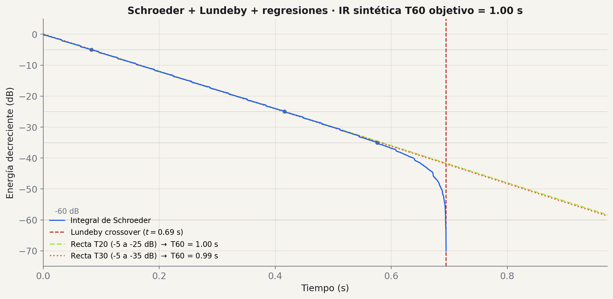

# M2 · Procesamiento de la RI

!!! info "Fechas y evaluación"
    - **Presentación de la consigna:** miércoles 21 de octubre 2026
    - **Fecha de entrega:** miércoles 4 de noviembre 2026 (sesión virtual)
    - **Tag de versión:** `v0.2.0`
    - **Evaluación:** seguimiento, sin nota (el grupo muestra su avance y recibe feedback por Slack)

## Objetivo

Implementar los **servicios de procesamiento** de la respuesta al impulso (RI): leer un audio, filtrarlo por bandas de octava, sintetizar RI con T60 conocidos para validar, obtener la RI de una grabación del sweep y pasarla a escala logarítmica. Al terminar este milestone, el sistema obtiene la RI a partir de una grabación del sine sweep y la deja lista para el análisis de M3, y la API suma **dos endpoints**: uno que genera una RI sintética y el primero que **recibe un archivo** (filtrar un WAV en una banda de octava).

---

## En el plano de la API

El mismo diagrama de M0, **parado en M2**: se encienden los services nuevos, en `signal_utils.py` y `filter.py`, al lado de los de M1 que ya existen, y dos endpoints más: `POST /signals/synthetic-ir` (en el router de M1) y `POST /filters/single-band` (en un router nuevo). Lo que queda punteado es el análisis de M3. Tocá cualquier recuadro para ver su estructura básica.

<div class="arq-marco" data-inicial="2">
--8<-- "arquitectura.html"
</div>

---

## De la grabación a la RI por bandas

En M1 generaron las señales que **excitan** la sala. En M2 usan la grabación para obtener la **respuesta al impulso** de la sala y dejarla lista para medirla: separada **por bandas de octava** y en **dB**. Los parámetros acústicos (EDT, T20, T30, C80, D50) se calculan en M3.

M2 son **cinco servicios**, presentados en el orden en que se apoyan uno en otro: el filtro de octava va antes que la RI sintética porque la RI sintética lo usa. Cada uno se presenta igual que en M1:

1. **Para qué sirve:** qué papel cumple en la medición y quién usa lo que devuelve.
2. **Qué es:** el concepto de Señales y Sistemas detrás.
3. **Probalo:** calculalo, escuchalo y miralo acá mismo.
4. **El código, archivo por archivo:** router, schema, service y test, en el orden en que viaja un pedido.

Dónde va cada cosa en el repositorio:

```text
rir-api/
├── app/
│   ├── services/
│   │   ├── signal_utils.py   ← Servicios 1, 3, 4 y 5 · load_audio, generate_synthetic_ir,
│   │   │                       get_impulse_response, logarithmic_scale_conversion   (M2)
│   │   └── filter.py         ← Servicio 2 · filter_single_band                     (M2)
│   ├── schemas/signals.py    ← + SyntheticIRRequest                                  (M2)
│   ├── routers/signals.py    ← + POST /api/v1/signals/synthetic-ir                   (M2)
│   ├── routers/filters.py    ← POST /api/v1/filters/single-band (router nuevo)       (M2)
│   └── main.py               ← registrar el router de filters                        (M2)
└── tests/
    ├── test_procesamiento.py ← los tests de los cinco servicios                      (M2)
    └── test_api.py           ← los tests de los dos endpoints y del 422              (M2)
```

Como en M1, el template ya trae los dos archivos de `services/` con las firmas y los docstrings, y los tests escritos (en `xfail` hasta que implementen cada función). Para recibir archivos trae resuelta la parte que no es de la materia: `uploaded_file` (en `app/routers/audio_http.py`) guarda el archivo subido en una carpeta temporal para que `load_audio` lo lea.

!!! note "De qué clases viene"
    **Clase 8 · Convolución y deconvolución:** convolución, sus propiedades (asociatividad) y deconvolución. Es el fundamento de `get_impulse_response`.

    **Clase 9 · Frecuencia y filtros:** FFT, espectros, Butterworth y bandas IEC 61260. Es el fundamento de `filter_single_band`.

!!! note "Los nombres coinciden con la API de referencia (casi)"
    `filter_single_band` y `generate_synthetic_ir` tienen el mismo nombre y orden de argumentos que en la API de cátedra ([Swagger](https://rir-api.onrender.com/docs)). Las diferencias están señaladas en cada servicio: `load_audio` y `get_impulse_response` no existen como función en la referencia, y `logarithmic_scale_conversion` allá se llama `logarithmicScaleConversion` (acá va en *snake_case*, como pide PEP 8 y la regla `N802` de `ruff`).

---

## Servicio 1 · `load_audio(path)`

### Para qué sirve

Es la **puerta de entrada** de todo audio que llega a la API: la grabación del sweep, una RI medida o una RI de un catálogo. Devuelve `(signal, fs)` y todo lo demás trabaja sobre eso.

- En M2 lo usa `POST /api/v1/filters/single-band`, el primer endpoint que **recibe un archivo**.
- En M3 lo usa el endpoint principal, que recibe la RI y devuelve los parámetros.

### Qué es

Leer un archivo de audio es pasar de **enteros** a **números reales**. Un WAV de 16 bits guarda cada muestra como un entero entre −32768 y 32767; uno de 24 bits, entre −8 388 608 y 8 388 607. `load_audio` los lleva siempre a `float64` entre −1 y 1, así el resto del procesamiento no depende de cómo se grabó.

Cómo se hace: se divide cada muestra por el **fondo de escala** del formato, $2^{N-1}$ para $N$ bits (32 768 en 16 bits, 8 388 608 en 24 bits). Así, el máximo que puede guardar el archivo pasa a valer 1, y una muestra de 16 384 en 16 bits pasa a valer 0,5, igual que 4 194 304 en 24 bits: **el mismo nivel queda con el mismo número**, se haya grabado como se haya grabado. Los WAV en punto flotante ya vienen en esa escala. `soundfile.read()` hace esta cuenta solo (devuelve `float64` por defecto).

Por qué importa:

- **El código de M2 y M3 se escribe una sola vez.** Filtros, umbrales en dB, la comparación con un piso de −120 dB: todo trabaja sobre la misma escala, sin `if` por formato.
- **`float64` y no enteros:** filtrar, convolucionar y sumar millones de muestras con enteros desborda o redondea; con `float64` (16 cifras significativas) el error numérico queda muy por debajo del ruido de cualquier grabación.

!!! warning "Escalar no es normalizar al pico"
    Dividir por el fondo de escala **conserva el nivel**: una grabación tomada con poco nivel queda chica (por ejemplo, con picos de 0,1), y eso es información, no un error. `load_audio` no la estira hasta 1. El test lo verifica: un estéreo con canales de 0,5 y 0,1 tiene que dar exactamente 0,3 en mono; si normalizan al pico, da 1 y el test falla. Normalizar al pico, cuando haga falta, es trabajo de otras funciones (por ejemplo, `get_impulse_response` normaliza la RI al pico).

Tres datos salen del **encabezado** del archivo, no de suposiciones:

- **`fs`**: las RI de los catálogos vienen a 44,1, 48 o 96 kHz. Si la asumen, todos los tiempos (y el T60) salen escalados.
- **Canales**: si el archivo es estéreo, se **promedian a mono** (`signal.mean(axis=1)`) y se documenta en el docstring.
- **Formato**: si el archivo no es un audio, `ValueError` con un mensaje claro (el router lo convierte en un 422). Si no existe, `FileNotFoundError`.

Para leer, `soundfile.read()`: lee WAV y FLAC (`scipy.io.wavfile` también sirve, pero solo lee WAV).

!!! warning "`soundfile` no lanza las excepciones que pide la firma"
    Si el archivo no existe, o existe pero no es un audio, `sf.read` lanza en los dos casos `soundfile.LibsndfileError` (un `RuntimeError`), no `FileNotFoundError` ni `ValueError`. Si la dejan pasar, fallan dos tests de `load_audio` y el endpoint responde 500 en lugar de 422. Dos pasos lo resuelven: verificar antes que el archivo exista (`Path(path).exists()`) y, al leer, capturar `sf.LibsndfileError` para relanzarla como `ValueError` con un mensaje que diga qué archivo falló y por qué.

### Probalo

Cargá un WAV de tu computadora (o la grabación de ejemplo) y mirá lo que devolvería `load_audio`: la `fs` del encabezado, los canales promediados a mono y la señal en [−1, 1]. Probá también con un archivo que no sea un audio, renombrado a `.wav`.

<div class="servicio-demo" data-servicio="load-audio"></div>

### El código, archivo por archivo

=== "Router"

    `load_audio` no tiene endpoint propio: lo llama el router de cualquier endpoint que reciba un archivo. Este es el fragmento de `/filters/single-band` (el router completo está en el servicio 2):

    <span class="ruta-archivo">app/routers/filters.py</span>

    ```python
    with uploaded_file(file) as path:                   # el archivo subido, en una carpeta temporal
        try:
            signal, fs = load_audio(path)
        except ValueError as e:                         # no es un audio: el pedido está mal
            raise HTTPException(status_code=422, detail=f"No es un audio válido: {e}")
    ```

    Para que el `except` funcione, `load_audio` tiene que lanzar `ValueError` cuando el archivo no es un audio. Si deja escapar otra excepción, la API responde 500 y el test del 422 falla.

=== "Schema"

    No tiene schema: el archivo llega como `UploadFile` en un formulario `multipart/form-data`, no como JSON. Los parámetros que lo acompañan (por ejemplo `center_freq`) se validan en la firma del router con `Form(..., gt=0)`.

=== "Service"

    <span class="ruta-archivo">app/services/signal_utils.py</span>

    ```python
    from pathlib import Path

    import numpy as np


    def load_audio(path: str | Path) -> tuple[np.ndarray, int]:
        """Carga un archivo de audio (al menos WAV y FLAC) y retorna senal y fs.

        La senal se devuelve **mono**: si el archivo es estereo (o multicanal) se
        promedian los canales. Se convierte a ``float64`` normalizada entre -1 y 1
        independientemente de la profundidad de bits original (16, 24 o 32 bits).
        Usar ``soundfile`` (o ``scipy.io.wavfile``).

        Parameters
        ----------
        path : str | Path
            Ruta al archivo de audio a cargar.

        Returns
        -------
        signal : np.ndarray
            Senal de audio mono como array 1D ``float64`` en [-1, 1].
        fs : int
            Frecuencia de muestreo del archivo en Hz.

        Raises
        ------
        FileNotFoundError
            Si el archivo especificado no existe.
        ValueError
            Si el archivo no es un audio valido o el formato no es soportado
            (con un mensaje claro que indique el archivo y el motivo).
        """
        raise NotImplementedError("Implementar en Milestone 2")   # ← acá va su implementación
    ```

    En la API de referencia no hay una función para esto: cada router lee el archivo con `soundfile.read` y promedia los canales. Acá se centraliza en `load_audio` para no repetir esa lógica en cada endpoint que recibe un archivo.

=== "Tests"

    <span class="ruta-archivo">tests/test_procesamiento.py</span>

    ```python
    def test_load_audio_stereo_to_mono(self, tmp_path):
        """Un WAV estereo se devuelve mono (promedio de canales)."""
        fs = 48000
        n = fs // 2
        izq = 0.5 * np.ones(n)
        der = 0.1 * np.ones(n)
        ruta = tmp_path / "estereo.wav"
        sf.write(ruta, np.column_stack([izq, der]), fs, subtype="FLOAT")

        senal, _ = load_audio(str(ruta))
        assert senal.ndim == 1
        assert len(senal) == n
        np.testing.assert_allclose(senal, 0.3, atol=1e-6)

    def test_load_audio_invalid_format(self, tmp_path):
        """Lanza ValueError si el archivo no es un audio valido."""
        ruta = tmp_path / "no_es_audio.wav"
        ruta.write_text("esto no es un archivo de audio")
        with pytest.raises(ValueError):
            load_audio(ruta)
    ```

    Los WAV de prueba se escriben en una carpeta temporal (`tmp_path`). En el mismo archivo están `test_load_audio_wav`, `test_load_audio_file_not_found` y `test_load_audio_normalization` (un PCM de 16 bits a plena escala tiene que llegar a más de 0,99, sin pasar de 1).

---

## Servicio 2 · `filter_single_band(signal, fs, center_freq, order)`

### Para qué sirve

La acústica de una sala **cambia con la frecuencia**: los graves reverberan más que los agudos. Por eso la ISO 3382 pide los parámetros **por banda de octava**, y este filtro es el que separa cada banda.

- En M2 lo usan `generate_synthetic_ir` (servicio 3), para armar cada banda de la RI sintética, y `POST /api/v1/filters/single-band`, que devuelve un WAV filtrado.
- En M3 lo usa el análisis: la RI se filtra banda por banda y de cada una salen sus EDT, T20, T30, C80 y D50.

### Qué es

Un **filtro pasabanda Butterworth** de una octava, con los bordes de la norma **IEC 61260**:

$$f_{inf} = \frac{f_c}{\sqrt{2}}, \qquad f_{sup} = f_c \cdot \sqrt{2}$$

| Banda | $f_c$ (Hz) | $f_{inf}$ – $f_{sup}$ (Hz) |
|---|---|---|
| 1 | 31,5 | 22,3 – 44,5 |
| 2 | 63 | 44,5 – 89,1 |
| 3 | 125 | 88,4 – 176,8 |
| 4 | 250 | 176,8 – 353,6 |
| 5 | 500 | 353,6 – 707,1 |
| 6 | 1 000 | 707,1 – 1 414,2 |
| 7 | 2 000 | 1 414,2 – 2 828,4 |
| 8 | 4 000 | 2 828,4 – 5 656,9 |
| 9 | 8 000 | 5 656,9 – 11 313,7 |
| 10 | 16 000 | 11 313,7 – 22 627,4 |

Cada banda es el doble de ancha que la anterior: la misma idea que el ruido rosa y el sweep de M1, que reparten la energía por igual entre octavas. La banda de 16 kHz no se puede usar a 44,1 kHz: su borde superior (22,6 kHz) queda por encima de Nyquist (22,05 kHz).

<small>La tabla usa las frecuencias **nominales** ($f_c$ redondeadas: 31,5, 63, 125…) y $\sqrt{2}$, que es lo que pide la consigna. Por eso los bordes no empalman perfecto (la banda 2 termina en 89,1 Hz y la 3 empieza en 88,4 Hz). La IEC 61260-1 define frecuencias medias exactas, $1000 \cdot 10^{3k/10}$ Hz, con las que sí empalman; para este TP la diferencia no cambia ningún resultado.</small>

Dos decisiones de implementación que cambian el resultado:

- **Forma SOS** (secciones de segundo orden): `scipy.signal.butter(..., output='sos')`. La forma `(b, a)` es numéricamente inestable en las bandas graves: a 44,1 kHz y orden 4, en 31,5 y 63 Hz el filtro devuelve `NaN`, y en 125 Hz quedan polos fuera del círculo unitario y la salida diverge.
- **Fase cero**: `scipy.signal.sosfiltfilt` aplica el filtro hacia adelante y hacia atrás, y la fase se cancela. Importa porque el filtro tiene su propia respuesta, más larga en los graves (la banda es angosta), que se suma a la caída de la sala: con una sola pasada (`sosfilt` o `lfilter`) puede inflar los T60 cortos de los graves. `sosfiltfilt` reduce ese efecto. El precio: la magnitud se aplica **dos veces**, y en los bordes la atenuación pasa de −3 dB a **−6 dB**.

### Probalo

Elegí una banda y un orden: arriba, la respuesta en frecuencia con una pasada (−3 dB en los bordes) y con dos (−6 dB), sobre el banco completo de bandas; abajo, el espectro de un ruido rosa antes y después del filtro. Escuchá cómo suena cada banda. Con más orden, los flancos son más empinados.

<div class="servicio-demo" data-servicio="filter-single-band"></div>

### El código, archivo por archivo

=== "Router"

    El primer endpoint que **recibe un archivo**: llega como `UploadFile` (formulario `multipart/form-data`) y los parámetros, como campos del mismo formulario (`Form`). Es el patrón que va a usar el endpoint principal de M3.

    <span class="ruta-archivo">app/routers/filters.py</span>

    ```python
    from fastapi import APIRouter, File, Form, HTTPException, UploadFile

    from app.routers.audio_http import uploaded_file, wav_response
    from app.services.filter import filter_single_band
    from app.services.signal_utils import load_audio

    router = APIRouter()


    @router.post("/single-band")                        # POST /api/v1/filters/single-band
    async def single_band(
        file: UploadFile = File(...),
        center_freq: float = Form(..., gt=0),
        order: int = Form(4, ge=1, le=8),
    ):
        with uploaded_file(file) as path:
            try:
                signal, fs = load_audio(path)
            except ValueError as e:                     # no es un audio: el pedido está mal
                raise HTTPException(status_code=422, detail=f"No es un audio válido: {e}")
        try:
            filtered = filter_single_band(signal, fs, center_freq, order)
        except ValueError as e:                         # la banda no entra en el archivo (ej. 16 kHz a 44,1 kHz)
            raise HTTPException(status_code=422, detail=f"Banda inválida para fs = {fs} Hz: {e}")
        return wav_response(filtered, fs, f"band_{center_freq:g}hz.wav")
    ```

    El segundo `try` cubre un caso que el schema no puede ver: si el borde superior de la banda pasa Nyquist (por ejemplo, 16 kHz en un archivo a 44,1 kHz), `scipy.signal.butter` lanza `ValueError`. Depende de la `fs` del archivo, que recién se conoce después de leerlo.

=== "Schema"

    No tiene un modelo de Pydantic: con archivos, FastAPI valida cada campo del formulario con las restricciones que se ponen en la firma del router (`Form(..., gt=0)`, `Form(4, ge=1, le=8)`). Si `center_freq` no es positiva, responde 422 igual que con un schema.

=== "Service"

    <span class="ruta-archivo">app/services/filter.py</span>

    ```python
    import numpy as np


    def filter_single_band(
        signal: np.ndarray, fs: int, center_freq: float, order: int = 4
    ) -> np.ndarray:
        """Aplica un filtro pasabanda de una octava centrado en ``center_freq`` (IEC 61260).

        Filtro Butterworth pasabanda (``scipy.signal.butter`` con ``output='sos'``)
        con frecuencias de corte:

        - inferior: ``center_freq / sqrt(2)``
        - superior: ``center_freq * sqrt(2)``

        Aplicarlo con ``scipy.signal.sosfiltfilt`` (fase cero), importante para no
        distorsionar EDT y T60. La forma ``(b, a)`` con ``filtfilt`` es inestable en
        las bandas graves.

        Parameters
        ----------
        signal : np.ndarray
            Senal de entrada (array 1D).
        fs : int
            Frecuencia de muestreo en Hz.
        center_freq : float
            Frecuencia central de la banda de octava en Hz.
        order : int, optional
            Orden del filtro Butterworth (por defecto 4).

        Returns
        -------
        np.ndarray
            Senal filtrada (array 1D, misma longitud que ``signal``).
        """
        raise NotImplementedError("Implementar en Milestone 2")   # ← acá va su implementación
    ```

    Mismo nombre y orden (`signal`, `fs`, `center_freq`) que `filter_single_band` de la API de referencia. El cuarto argumento difiere: la de cátedra recibe `bandwidth` (`'octave'` o `'third'`); acá solo se piden octavas y el cuarto argumento es el `order` del Butterworth.

=== "Tests"

    <span class="ruta-archivo">tests/test_procesamiento.py</span>

    ```python
    def _respuesta_en_frecuencia(fc: float, fs: int) -> tuple[np.ndarray, np.ndarray]:
        """Respuesta en frecuencia (dB) de filter_single_band medida con un impulso centrado."""
        n = fs  # 1 s -> resolucion de 1 Hz
        delta = np.zeros(n)
        delta[n // 2] = 1.0
        h = filter_single_band(delta, fs, fc)
        mag = np.abs(np.fft.rfft(h))
        f = np.fft.rfftfreq(n, 1 / fs)
        return f, 20 * np.log10(mag + 1e-300)


    def test_filter_single_band_frequency_response(self):
        """0 dB en fc, caida en los bordes de banda y > 20 dB a una octava de distancia."""
        fs, fc = 48000, 1000.0
        f, h_db = _respuesta_en_frecuencia(fc, fs)

        def ganancia(freq: float) -> float:
            return float(np.interp(freq, f, h_db))

        assert abs(ganancia(fc)) <= 0.5
        # Butterworth: -3 dB en los bordes con una pasada (lfilter/sosfilt);
        # con filtfilt la magnitud se eleva al cuadrado y queda en -6 dB.
        for f_borde in (fc / np.sqrt(2), fc * np.sqrt(2)):
            assert -7.0 <= ganancia(f_borde) <= -2.0
        assert ganancia(fc / 2) < -20
        assert ganancia(2 * fc) < -20
    ```

    El test mide la respuesta del filtro **que implementaron** pasándole un impulso: la FFT de la salida es la respuesta en frecuencia (lo mismo que dibuja la demo). En el mismo archivo están `test_filter_single_band_center_frequency` (un seno en $f_c$ pasa con ±1 dB) y `test_filter_single_band_attenuation` (uno en $4 f_c$ queda más de 20 dB abajo).

    El test del endpoint es `test_filters_single_band_endpoint` en `tests/test_api.py`: sube un WAV de ruido y verifica que vuelva otro WAV del mismo largo y la misma `fs`.

---

## Servicio 3 · `generate_synthetic_ir(duration, t60_values, fs)`

### Para qué sirve

Es una **sala de laboratorio**: una RI cuyos T60 por banda **se conocen de antemano** porque se eligieron. Sirve para validar sin salir a medir:

- En M2, para probar la deconvolución (servicio 4): se "graba" el sweep a través de una RI sintética y se verifica que se recupere.
- En M3, para validar el análisis: si piden T60 = 1,2 s en 500 Hz y el cálculo devuelve 1,8 s, hay un bug.

La API la expone en `POST /api/v1/signals/synthetic-ir`, que devuelve el WAV.

### Qué es

Una RI idealizada de un recinto es **ruido que decae exponencialmente**. Por banda:

$$h_i(t) = n_i(t) \cdot e^{-\alpha_i t}, \qquad h(t) = \sum_i h_i(t)$$

donde $n_i(t)$ es ruido blanco filtrado en la octava $i$ (con `filter_single_band`) y $\alpha_i$ sale de pedir que en $t = T_{60}$ la amplitud haya caído 60 dB:

$$20 \log_{10}\left(e^{-\alpha T_{60}}\right) = -60 \text{ dB} \quad\Rightarrow\quad \alpha = \frac{60}{T_{60} \cdot 20 \log_{10}(e)} = \frac{3 \ln(10)}{T_{60}} \approx \frac{6{,}908}{T_{60}}$$

Procedimiento:

1. Para cada banda de `t60_values`: generar ruido blanco de `duration` segundos, filtrarlo en la octava y multiplicarlo por $e^{-\alpha t}$.
2. Sumar las bandas.
3. Normalizar al pico.

!!! tip "Normalizar cada banda por su RMS"
    Antes de aplicar la envolvente, dividan cada banda filtrada por su RMS. El ruido blanco tiene la misma energía por hertz, así que una banda aguda (miles de Hz de ancho) tiene mucha más energía que una grave (decenas de Hz): sin normalizar, las agudas tapan a las graves en la suma. El test de decaimiento usa una sola banda y no lo detecta, pero con varias bandas los T60 de los graves salen mal medidos (lo pueden ver en la tabla de la demo).

### Probalo

Elegí una sala (cada una con sus T60 por banda): arriba, la RI; abajo, la curva de caída de cada banda (la integral de Schroeder, que viene en M3) junto con la caída pedida. La tabla compara el T60 pedido con el medido, como hace el test.

<div class="servicio-demo" data-servicio="synthetic-ir"></div>

### El código, archivo por archivo

=== "Router"

    Igual que el ruido rosa de M1: va en el mismo router de `signals` y responde un WAV con `wav_response`. Escribirlo es parte de M2.

    <span class="ruta-archivo">app/routers/signals.py</span>

    ```python
    # arriba del archivo: from app.schemas.signals import SyntheticIRRequest
    #                     from app.services.signal_utils import generate_synthetic_ir

    @router.post("/synthetic-ir")                       # POST /api/v1/signals/synthetic-ir
    async def synthetic_ir(req: SyntheticIRRequest):
        ...  # llamar a generate_synthetic_ir y responder con wav_response
    ```

=== "Schema"

    <span class="ruta-archivo">app/schemas/signals.py</span>

    ```python
    class SyntheticIRRequest(BaseModel):
        duration: float = Field(gt=0, le=10)
        t60_values: dict[PositiveFloat, PositiveFloat]  # {frecuencia_central: T60}, ej. {"1000": 0.8}
        sample_rate: int = Field(default=44100, ge=8000, le=192000)
    ```

    `PositiveFloat` (de `pydantic`) rechaza con 422 una frecuencia o un T60 que no sean positivos: con `dict[float, float]` pasaría `{"1000": -1}`, y un T60 negativo hace crecer la envolvente en lugar de decaer.

    En JSON las claves de un diccionario son siempre texto (`"1000"`); Pydantic las convierte a `float` porque el schema lo dice.

=== "Service"

    <span class="ruta-archivo">app/services/signal_utils.py</span>

    ```python
    def generate_synthetic_ir(duration: float, t60_values: dict[float, float], fs: int) -> np.ndarray:
        """Sintetiza una respuesta al impulso con valores de T60 conocidos por banda.

        Modelo: ``h(t) = n(t) * exp(-alpha * t)`` con ``alpha = 3 * ln(10) / T60``,
        donde ``n(t)`` es ruido blanco filtrado en la banda de octava. Se suman las
        componentes de todas las bandas y se normaliza.

        Parameters
        ----------
        duration : float
            Duracion de la respuesta al impulso en segundos.
        t60_values : dict[float, float]
            Diccionario ``{frecuencia_central_Hz: T60_segundos}``.
            Ejemplo: ``{125: 2.0, 250: 1.8, 500: 1.5, 1000: 1.2, 2000: 1.0, 4000: 0.8}``.
        fs : int
            Frecuencia de muestreo en Hz.

        Returns
        -------
        np.ndarray
            Respuesta al impulso sintetizada (array 1D de ``int(duration * fs)`` muestras).
        """
        raise NotImplementedError("Implementar en Milestone 2")   # ← acá va su implementación
    ```

    `generate_synthetic_ir` de la API de referencia recibe además `bandwidth` (octavas o tercios) y parámetros opcionales (`amplitude`, `noise`, `displacement_time`, `output_path`). Acá alcanza con octavas y los tres argumentos obligatorios, en el mismo orden.

=== "Tests"

    <span class="ruta-archivo">tests/test_procesamiento.py</span>

    ```python
    def _t60_desde_schroeder(ir: np.ndarray, fs: int) -> float:
        """T60 extrapolado de la pendiente de Schroeder entre -5 y -25 dB (T20)."""
        energia = np.cumsum(ir[::-1] ** 2)[::-1]
        edc = 10 * np.log10(energia / energia[0] + 1e-300)
        t = np.arange(len(ir)) / fs
        tramo = (edc <= -5) & (edc >= -25)
        pendiente = np.polyfit(t[tramo], edc[tramo], 1)[0]
        return -60 / pendiente


    def test_synthetic_ir_decay(self):
        """El decaimiento en la banda de 1 kHz corresponde a T60 = 2 s (+-10 %)."""
        fs, t60 = 44100, 2.0
        ir = generate_synthetic_ir(3 * t60, {1000: t60}, fs)
        sos = sps.butter(4, [1000 / np.sqrt(2), 1000 * np.sqrt(2)], "bandpass", fs=fs, output="sos")
        ir_banda = sps.sosfiltfilt(sos, ir)
        t60_medido = _t60_desde_schroeder(ir_banda, fs)
        assert abs(t60_medido - t60) <= 0.1 * t60, f"T60 medido = {t60_medido:.2f} s"
    ```

    Es la tabla de la demo: filtra la RI en la banda, calcula la curva de Schroeder y mide la pendiente entre −5 y −25 dB. En el mismo archivo está `test_synthetic_ir_duration` (largo de `int(duration * fs)` muestras).

    El test del endpoint es `test_signals_synthetic_ir_endpoint` en `tests/test_api.py`: pide 1 s con `{"1000": 0.8}` y verifica que vuelva un WAV de 44100 muestras.

---

## Servicio 4 · `get_impulse_response(recording, inverse_filter)`

### Para qué sirve

Es el paso que **cierra la medición** del método de Farina:

1. En M1, `generate_sine_sweep_pair` dio el sweep y su filtro inverso.
2. `play_and_record` reprodujo el sweep en la sala y devolvió la grabación.
3. **Este servicio** convoluciona la grabación con el filtro inverso y devuelve la **respuesta al impulso de la sala**.

Lo que devuelve es la entrada de todo M3: se filtra por bandas (servicio 2), se pasa a dB (servicio 5) y de ahí salen los parámetros.

### Qué es

Si la sala es un sistema **LTI**, queda caracterizada por su respuesta al impulso $h(t)$: para cualquier señal $x(t)$ que suene en ella, lo que capta el micrófono es

$$y(t) = x(t) * h(t)$$

Si pudiéramos reproducir un impulso perfecto, la grabación **sería** $h(t)$, porque $\delta * h = h$. Ningún parlante puede (un impulso tiene amplitud infinita), pero el sweep y su filtro inverso cumplen $x * x_{inv} \approx \delta$, como vieron en M1. Convolucionando la grabación con el filtro inverso, por **asociatividad** de la convolución:

$$y * x_{inv} = (x * h) * x_{inv} = h * (x * x_{inv}) \approx h * \delta = h$$

En frecuencia se ve todavía más claro: convolucionar es multiplicar los espectros, y el producto $X(f) \cdot X_{inv}(f)$ es plano (lo vieron en la demo del sweep):

$$\mathcal{F}\{y * x_{inv}\} = X(f)\, H(f)\, X_{inv}(f) = H(f)\, \underbrace{X(f)\, X_{inv}(f)}_{\approx\, 1}$$

| Qué tienen | De dónde sale |
|---|---|
| `sweep` · $x(t)$ | M1: `generate_sine_sweep_pair(duration, f1, f2, fs)` |
| `inverse_filter` · $x_{inv}(t)$ | M1: el segundo valor que devuelve `generate_sine_sweep_pair` |
| `recording` · $y(t)$ | M1: `play_and_record`, el micrófono en la sala |
| $h(t)$ · la RI | **M2: `get_impulse_response(recording, inverse_filter)`** |

La implementación:

1. Convolucionar con `scipy.signal.fftconvolve(recording, inverse_filter, mode='full')`: por FFT es órdenes de magnitud más rápido que `np.convolve` para señales de varios segundos.
2. Ubicar el **pico** (`np.argmax(np.abs(...))`): es la llegada del sonido directo. No cae en la primera muestra: en la práctica $x * x_{inv} \approx \delta(t - T)$, un impulso **corrido la duración del sweep**, así que en la salida completa el pico aparece cerca de $T$ más el tiempo que tarda el sonido en llegar al micrófono. Por eso hay que buscarlo. Antes del pico no hay información de la sala.
3. **Recortar** para que la RI empiece en el pico o un poco antes, y **normalizar** respecto del pico.

> **Material extendido:** [Álgebra de la deconvolución](m2_algebra_deconvolucion.md): la derivación detallada, la comparación con MLS y referencias.

<small>Farina, A. (2000). "Simultaneous measurement of impulse response and distortion with a swept-sine technique." *108th AES Convention*.</small>

### Probalo

Una sala simulada con el T60 que elijas: el sweep suena en ella, se graba con ruido de fondo y `get_impulse_response` recupera la RI. Abajo, la RI de la sala y la recuperada en dB. Escuchá el sweep, la grabación y la RI. Subí el ruido o acortá el sweep y mirá cómo sube el piso de la RI recuperada.

<div class="servicio-demo" data-servicio="impulse-response"></div>

### El código, archivo por archivo

=== "Router"

    No tiene endpoint en M2: lo usa el análisis completo de M3, que recibe la RI (o la grabación) y devuelve los parámetros. Exponer todo no es el objetivo; exponer lo que un cliente necesita, sí.

=== "Schema"

    No tiene schema: no hay un pedido HTTP que validar.

=== "Service"

    <span class="ruta-archivo">app/services/signal_utils.py</span>

    ```python
    def get_impulse_response(recording: np.ndarray, inverse_filter: np.ndarray) -> np.ndarray:
        """Obtiene la respuesta al impulso mediante deconvolucion de un sine sweep.

        ``h(t) = y(t) * x_inv(t)``, con ``y = recording`` y ``x_inv = inverse_filter``;
        usar ``scipy.signal.fftconvolve`` (``mode='full'``), recortar para que la RI
        comience en el pico (o ligeramente antes) y normalizar respecto del pico.

        Parameters
        ----------
        recording : np.ndarray
            Senal grabada que contiene la respuesta de la sala al sweep.
        inverse_filter : np.ndarray
            Filtro inverso del sweep utilizado.

        Returns
        -------
        np.ndarray
            Respuesta al impulso estimada, normalizada.
        """
        raise NotImplementedError("Implementar en Milestone 2")   # ← acá va su implementación
    ```

    En la API de referencia no hay una función con este nombre: la deconvolución se hace con la función genérica `convolve_signals(recording, inverse_filter)` (endpoint `/signals/convolve`). Acá se pide como función propia porque además recorta en el pico y normaliza.

=== "Test"

    <span class="ruta-archivo">tests/test_procesamiento.py</span>

    ```python
    def test_impulse_response_peak():
        """La RI recuperada por deconvolucion se parece a la original (correlacion > 0.9)."""
        fs = 44100
        rng = np.random.default_rng(0)

        # RI conocida: sonido directo + cola exponencial, limitada a 100 Hz - 10 kHz
        # (dentro del rango del sweep) con un filtro causal.
        n = int(0.5 * fs)
        t = np.arange(n) / fs
        ir = 0.3 * rng.standard_normal(n) * np.exp(-3 * np.log(10) / 0.3 * t)
        ir[0] = 1.0
        sos = sps.butter(2, [100, 10000], "bandpass", fs=fs, output="sos")
        ir = sps.sosfilt(sos, ir)

        sweep, inverse_filter = generate_sine_sweep_pair(2.0, 20, 20000, fs)
        recording = sps.fftconvolve(sweep, ir)  # grabacion simulada
        ir_rec = get_impulse_response(recording, inverse_filter)

        # Alinear por correlacion cruzada y comparar el tramo superpuesto.
        ...
        assert correlacion > 0.9, f"correlacion = {correlacion:.3f}"
    ```

    Simula lo mismo que la demo, sin ruido: una sala conocida, el sweep de **su** `generate_sine_sweep_pair` de M1 y la grabación como `sweep ∗ ir`. Por eso este test también verifica que M1 y M2 encajen: si el filtro inverso de M1 está mal, la RI no se recupera.

---

## Servicio 5 · `logarithmic_scale_conversion(signal)`

### Para qué sirve

Pasa una señal a **dB respecto de su máximo**. Es la escala en la que se **lee** una RI: la caída de 60 dB que define el T60 en lineal es una caída de 1 a 0,001, y se pierde pegada al cero.

- En M3, para ver y medir el decaimiento por banda: en dB, una caída exponencial es una **recta**, y su pendiente da el T60.
- Para comparar el rango dinámico de una RI con su ruido de fondo.

### Qué es

$$L(t) = 20 \log_{10}\left(\frac{|h(t)|}{\max |h(t)|}\right)$$

El máximo queda en 0 dB y todo lo demás es negativo. Con amplitud se usa $20 \log_{10}$; con energía ($h^2$), $10 \log_{10}$: dan lo mismo.

Dos detalles que no están en la fórmula:

- **El logaritmo de cero** es $-\infty$: antes del log, reemplazar los ceros por un valor mínimo (`np.finfo(float).eps`, ≈ $2{,}2 \times 10^{-16}$).
- **Un piso opcional** (por ejemplo −120 dB) para que los gráficos no se vayan al fondo.

Y por qué una exponencial es una recta en dB: $20 \log_{10}\left(e^{-\alpha t}\right) = -\alpha t \cdot 20 \log_{10}(e) \approx -8{,}69\, \alpha\, t$, una función lineal de $t$.

### Probalo

La misma RI (T60 = 1 s, con ruido de fondo) en lineal y en dB. En lineal, después de unos cientos de milisegundos parece que no pasa nada; en dB se ve la recta de caída hasta el ruido de fondo. Mové el piso y mirá qué parte del gráfico recorta.

<div class="servicio-demo" data-servicio="log-scale"></div>

### El código, archivo por archivo

=== "Router"

    No tiene endpoint: lo usa el análisis de M3 y sirve para graficar la validación de M2.

=== "Schema"

    No tiene schema: no hay un pedido HTTP que validar.

=== "Service"

    <span class="ruta-archivo">app/services/signal_utils.py</span>

    ```python
    def logarithmic_scale_conversion(signal: np.ndarray) -> np.ndarray:
        """Convierte una senal a escala logaritmica (dB) normalizada.

        ``L = 20 * log10(|x| / max(|x|))``. Evitar ``log(0)`` (usar un ``eps`` o
        un piso, por ejemplo -120 dB).

        Parameters
        ----------
        signal : np.ndarray
            Senal de entrada (valores lineales, array 1D).

        Returns
        -------
        np.ndarray
            Senal en dB, normalizada a 0 dB en el maximo.
        """
        raise NotImplementedError("Implementar en Milestone 2")   # ← acá va su implementación
    ```

    En la API de referencia se llama `logarithmicScaleConversion`. Acá va en *snake_case*: lo pide PEP 8 y lo controla la regla `N802` de `ruff`, que el CI tiene activada.

=== "Tests"

    <span class="ruta-archivo">tests/test_procesamiento.py</span>

    ```python
    def test_logarithmic_scale_max_zero(self):
        """El valor maximo de la salida es 0 dB."""
        x = np.array([0.1, 1.0, 0.5, 0.25])
        db = logarithmic_scale_conversion(x)
        assert abs(np.max(db)) < 1e-10
        assert int(np.argmax(db)) == 1

    def test_logarithmic_scale_ratio(self):
        """Una senal con amplitud mitad da -6 dB."""
        db = logarithmic_scale_conversion(np.array([1.0, 0.5]))
        assert abs(db[1] - 20 * np.log10(0.5)) < 0.1
    ```

    En el mismo archivo está `test_logarithmic_scale_type` (devuelve un `np.ndarray` del mismo largo).

---

## Los endpoints de M2

Con los dos routers escritos (el de la RI sintética en el servicio 3 y el del filtro en el servicio 2), falta **registrarlos** y **probarlos**.

1. **Registrar el router nuevo** en `app/main.py` (está en el `TODO (M2)`). El de `/synthetic-ir` no necesita registro: va en el router de `signals`, que ya registraron en M1.

    ```python
    from app.routers import filters, health, signals

    app.include_router(filters.router, prefix="/api/v1/filters", tags=["filters"])
    ```

2. **Probarlo en Swagger:** `uv run uvicorn app.main:app --reload`, abrir `http://localhost:8000/docs`, desplegar `POST /api/v1/filters/single-band` y en *Try it out* elegir el archivo. Suban una RI, pidan la banda de 1 kHz y escuchen el resultado. Prueben subir un archivo que no sea un audio: tiene que volver **422**.
3. **Probarlo desde la terminal**, para el README:

    ```bash
    curl -X POST http://localhost:8000/api/v1/filters/single-band \
         -F "file=@ri.wav" -F "center_freq=1000" -o banda_1k.wav

    curl -X POST http://localhost:8000/api/v1/signals/synthetic-ir \
         -H "Content-Type: application/json" \
         -d '{"duration": 2, "t60_values": {"500": 1.2, "1000": 1.0}}' -o ri_sintetica.wav
    ```

4. **Sacar las marcas `xfail`** y ver pasar los tests:
    - En `tests/test_api.py`, el decorador `@xfail_m2` de los tres tests de M2 (los dos endpoints y el 422).
    - En `tests/test_procesamiento.py`, la línea `pytestmark = pytest.mark.xfail(...)` de arriba de todo, que marca el archivo entero. Bórrenla cuando pasen los cinco servicios: hasta entonces, los tests que ya andan aparecen como `XPASS` (pasan, pero siguen marcados).

!!! note "Qué queda para M3"
    `get_impulse_response` y `logarithmic_scale_conversion` no tienen endpoint propio: los usa el análisis completo de M3, que recibe la RI y devuelve los parámetros con el mismo patrón que `/filters/single-band`. M3 empieza con cinco endpoints andando: la API se completa, no se empieza.

---

## Validación

Los tests automatizados son condición necesaria, no suficiente. Además, cada grupo valida a mano:

1. **Con RI reales.** Descargar al menos **dos RI** medidas, una de T60 largo y otra corto. El sitio `openairlib.net` (OpenAIR) está fuera de línea desde septiembre de 2026; si no vuelve, usen el [MIT IR Survey](https://mcdermottlab.mit.edu/Reverb/IR_Survey.html) (271 RI de recintos reales) o una RI medida por la cátedra. Cárguenlas con `load_audio` (ojo: vienen a distintas `fs` y profundidades de bits), fíltrenlas por bandas y grafiquen la forma de onda, el espectro y el decaimiento en dB de cada banda.
2. **Con la RI sintética.** Sinteticen una RI con T60 conocidos, simulen la grabación (`sweep ∗ ri`), recupérenla con `get_impulse_response` y comparen: la recuperada tiene que parecerse a la original.
3. **Contra software de referencia.** Procesen las mismas RI con **REW** (Room EQ Wizard, gratuito), ARTA o Aurora, y suban la misma RI al [frontend de cátedra](https://rir-api-frontend.onrender.com): los resultados no deberían diferir mucho (se evalúa en detalle en M3).

Las gráficas y capturas van en `docs/m2/` del repo, enlazadas desde el README, con la comparación documentada.

!!! note "Referencia visual"
    Comparen sus gráficos con las demos de esta página. Los valores deberían estar en el mismo orden:

    - Filtro de octava: 0 dB en $f_c$, −6 dB en los bordes con `sosfiltfilt`, más de 20 dB de atenuación a una octava.
    - RI sintética: T60 medido dentro del 10 % del pedido en cada banda.
    - Deconvolución: correlación con la RI original mayor a 0,9.

    Si su resultado se ve muy distinto al de las demos, hay un bug: empiecen por ahí.

---

## Calidad de código

Todos los requisitos de M1 aplican, más:

- **Modularidad:** las funciones de M2 van en `signal_utils.py` y `filter.py`, como en el árbol de arriba. Ninguna importa nada de FastAPI.
- **Cobertura de tests:** al menos 80 % en las funciones de M2 (`uv run pytest --cov=app/services`). El informe sale por archivo e incluye los de M1 y M3: miren las filas de `signal_utils.py` y `filter.py`.
- **CI en verde** en cada push: lint y tests.
- **Tag:** al completar el milestone, crear el tag `v0.2.0` en `main`.

---

## Guía de entrega

### Buenas prácticas del código de referencia

Patrones aplicados en la API de cátedra. No los pide la rúbrica, pero les ahorran trabajo en M3 y mejoran la precisión numérica.

!!! note "01 · Mono y estéreo en una línea"
    `if signal.ndim > 1: signal = signal.mean(axis=1)`
    Va dentro de `load_audio`: así el resto del procesamiento recibe siempre una señal mono.

!!! note "02 · `sosfiltfilt` para fase cero"
    Forma SOS y filtrado hacia adelante y hacia atrás. Es crítico para medir T60 correctamente en todas las bandas.

!!! note "03 · `fftconvolve` para deconvolucionar"
    Para una grabación de 10 s a 48 kHz, la diferencia con `np.convolve` es de milisegundos a minutos.

!!! note "04 · Evitar el logaritmo de cero"
    `np.maximum(np.abs(x), np.finfo(float).eps)` antes del log, y opcionalmente un piso de −120 dB después. Evita `-inf` en los gráficos y en los cálculos.

!!! note "05 · Probar M1 y M2 juntos"
    El test de la deconvolución usa el sweep de su M1. Si lo rompen al tocar M1, lo van a ver en M2: corran siempre la suite completa (`uv run pytest -v`), no solo el archivo que están tocando.

### Lo que mira el docente

**Código**

- [ ] Docstrings NumPy y type hints en las 5 funciones
- [ ] Tests de `tests/test_procesamiento.py` pasando, sin `xfail`
- [ ] Ninguna función de `services/` importa FastAPI

**Git**

- [ ] Cada función en una rama propia, mergeada vía PR con review de otro integrante
- [ ] Historial coherente (no un commit gigante "M2")
- [ ] Tag `v0.2.0` anotado y empujado al remote

### Checklist de entrega

Lo que tiene que estar en el tag `v0.2.0` el 4/11.

- [ ] `load_audio` con sus tests pasando (WAV, estéreo a mono, normalización, errores)
- [ ] `filter_single_band` con sus tests pasando
- [ ] `generate_synthetic_ir` con el test de decaimiento pasando
- [ ] `get_impulse_response` con el test de correlación pasando
- [ ] `logarithmic_scale_conversion` con sus tests pasando
- [ ] Endpoints `POST /api/v1/signals/synthetic-ir` y `POST /api/v1/filters/single-band` registrados en `main.py`, devolviendo WAV
- [ ] Los tres tests de M2 de `tests/test_api.py` pasando (sin la marca `@xfail_m2`)
- [ ] Cobertura de al menos 80 % en las funciones de M2
- [ ] Los ejemplos `curl` en el README
- [ ] La validación (2 o más RI reales y la comparación con REW o equivalente) en `docs/m2/`, enlazada desde el README
- [ ] M1 sigue andando: `pytest -v` en verde con todos los tests
- [ ] PRs mergeados, no commits directos a `main`
- [ ] Tag `v0.2.0` anotado y empujado al remote

---

## Próxima parada · M3

<figure class="figura-tp" markdown>
[](../img/m2/schroeder_lundeby.png)
<figcaption markdown="span">Integral de Schroeder · cruce de Lundeby · regresiones para T20 y T30 sobre una RI sintética de T60 = 1,0 s</figcaption>
</figure>

Con la RI filtrada por banda y en dB, lo que viene es **medirla**. M3 (entrega el 18 de noviembre) suma:

- **Integral de Schroeder:** $S(t) = \int_t^\infty h^2(\tau)\, d\tau$, la energía que queda desde $t$ en adelante. Convierte la RI ruidosa en una curva monótona (es la que dibuja la demo del servicio 3). En código: `np.cumsum(x[::-1] ** 2)[::-1]`.
- **Regresión lineal** sobre esa curva para EDT, T20 y T30, y los parámetros de energía C80 y D50, por banda.
- **Lundeby** (opcional): el punto donde el decaimiento se mezcla con el ruido de fondo, para cortar la integral ahí.
- El endpoint que recibe la RI y devuelve los parámetros, la validación, la demo y la presentación oral.

## Recursos

- [MIT IR Survey (respuestas al impulso reales)](https://mcdermottlab.mit.edu/Reverb/IR_Survey.html)
- [soundfile: documentación](https://python-soundfile.readthedocs.io/)
- [scipy.signal.butter](https://docs.scipy.org/doc/scipy/reference/generated/scipy.signal.butter.html)
- [scipy.signal.sosfiltfilt](https://docs.scipy.org/doc/scipy/reference/generated/scipy.signal.sosfiltfilt.html)
- [scipy.signal.fftconvolve](https://docs.scipy.org/doc/scipy/reference/generated/scipy.signal.fftconvolve.html)
- [Farina, A. (2000) - Swept-sine technique (PDF)](https://www.angelofarina.it/Public/Papers/134-AES00.PDF)
- [IEC 61260-1:2014 - Octave-band and fractional-octave-band filters](https://www.iso.org/standard/69056.html)
- [REW - Room EQ Wizard (software gratuito)](https://www.roomeqwizard.com/)
