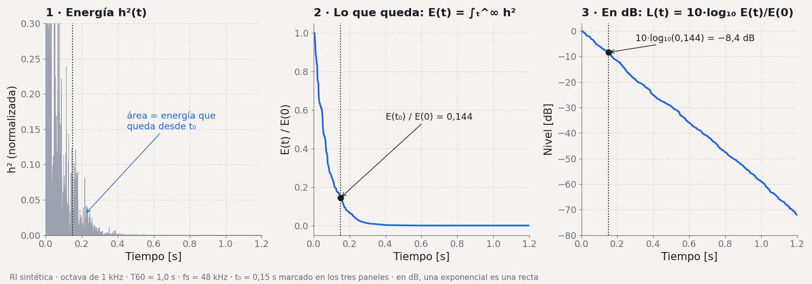
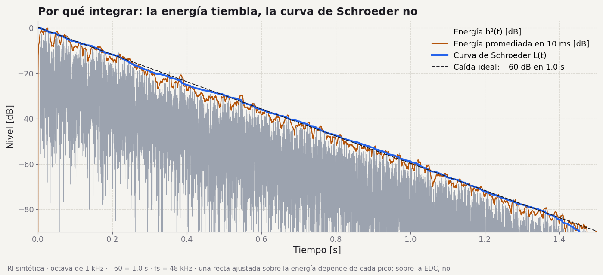
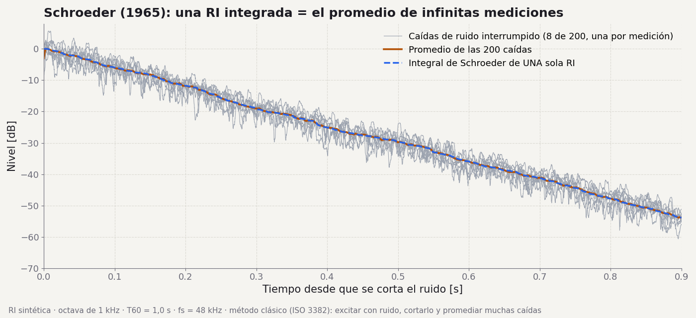
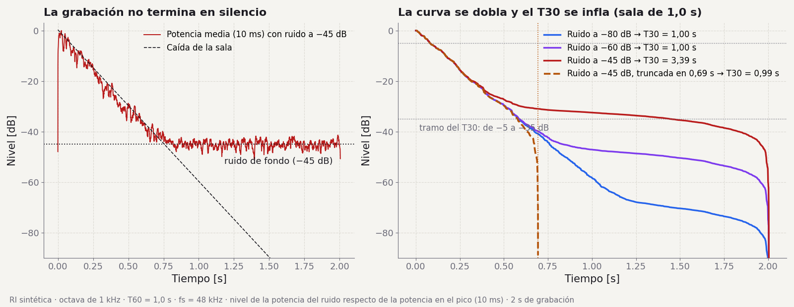
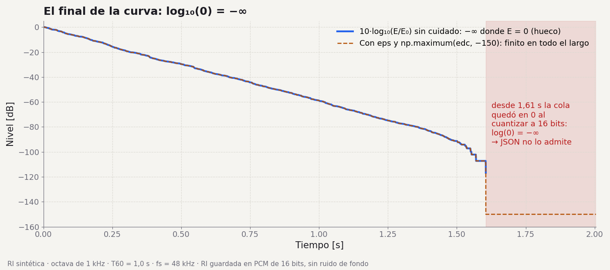
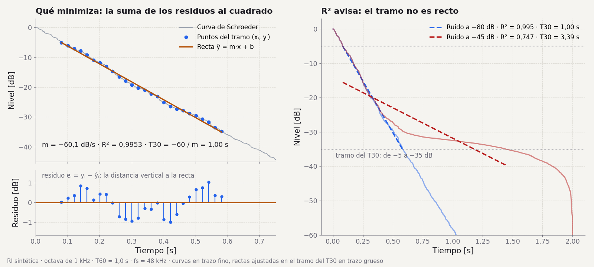
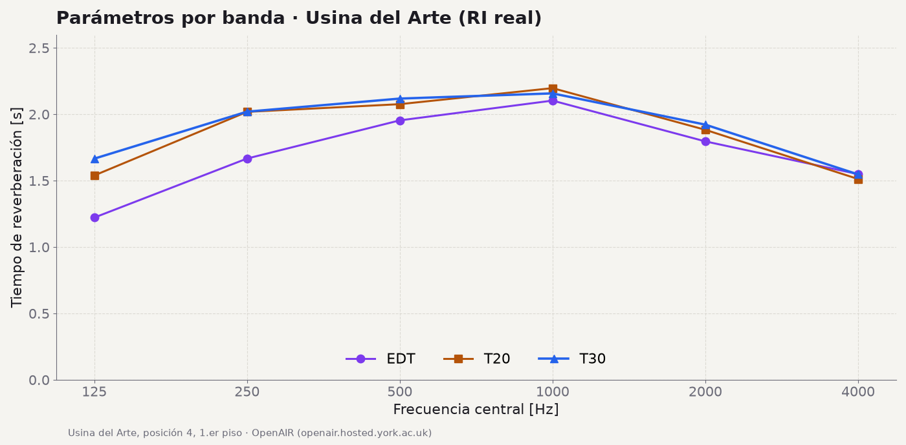
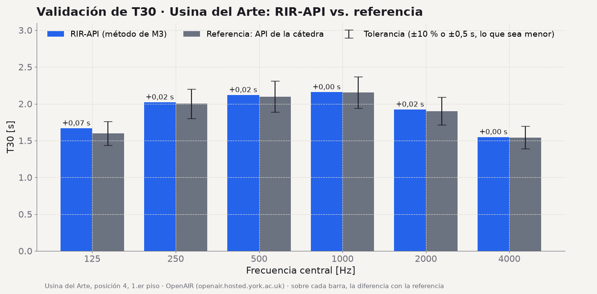
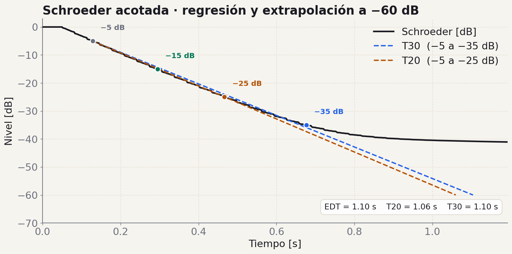
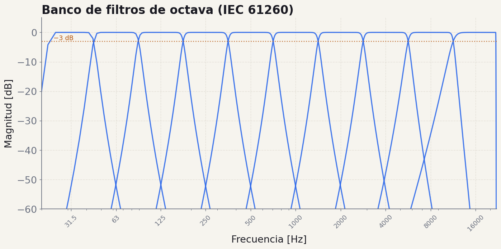

# M3 · Producto final

!!! info "Fechas y evaluación"
    - **Presentación de la consigna:** miércoles 28 de octubre 2026
    - **Fecha de entrega:** miércoles 18 de noviembre 2026, junto con la presentación oral (Demo Day)
    - **Tag de versión:** `v1.0.0`
    - **Evaluación:** **con nota**: Nota del TP = 60 % M3 + 40 % presentación oral (ver [rúbrica](../rubrica.md))

## Objetivo

Completar el sistema RIR-API con los **servicios de análisis** (suavizado, integral de Schroeder, regresión lineal y cálculo de parámetros según ISO 3382) y **completar la API REST** que empezaron en M1: el endpoint que recibe una RI y devuelve los parámetros por banda, y dos de utilidades. Al terminar, la API recibe una respuesta al impulso por HTTP, la procesa y devuelve EDT, T20, T30, D50 y C80 por banda de octava, con resultados validados contra software de referencia.

> **Referencia:** la [documentación interactiva de la API de la cátedra](https://rir-api.onrender.com/docs) muestra endpoints, schemas y respuestas de una implementación completa.

---

## En el plano de la API

El mismo diagrama de M0, **parado en M3**: se encienden los services de análisis y los endpoints que faltaban (`acoustics.py` y `utils.py`, con sus schemas). M1 y M2 dejan la base: la API ya genera señales, sintetiza RI y filtra archivos, y en M3 se completa. Tocá **Recorrido de un análisis** para seguir un pedido de punta a punta: sube un WAV, pasa por cada capa y vuelve como JSON.

<div class="arq-marco" data-inicial="3">
--8<-- "arquitectura.html"
</div>

---

## De la RI a los parámetros

En M2 obtuvieron la RI de una sala y la separaron por bandas. En M3 la **miden**: de cada banda sale una curva de caída, y de esa curva salen los números que describen la sala. Es el último paso de la cadena del TP y el que convierte la API en un **producto**: un servicio web al que cualquiera le sube una RI y recibe sus parámetros acústicos, con resultados que coinciden con los de un software profesional.

M3 son **cuatro servicios**, presentados en el orden en que se encadenan, y cada uno con el mismo formato que M1 y M2:

1. **Para qué sirve:** qué papel cumple en el análisis y quién usa lo que devuelve.
2. **Qué es:** el concepto de Señales y Sistemas (y de acústica) detrás.
3. **Probalo:** calculalo y miralo acá mismo.
4. **El código, archivo por archivo:** router, schema, service y test.

Dónde va cada cosa en el repositorio:

```text
rir-api/
├── app/
│   ├── services/
│   │   └── acoustic_parameters.py ← Servicios 1 a 4 · apply_smoothing, apply_schroeder_integral,
│   │                                linear_regression, calculate_parameters_from_ir
│   │                                (+ apply_lundeby, opcional)                       (M3)
│   ├── schemas/
│   │   ├── responses.py           ← BandAnalysisResponse                              (M3)
│   │   └── utils.py               ← SmoothingMethod, SmoothingResponse, SchroederResponse (M3)
│   ├── routers/
│   │   ├── acoustics.py           ← POST /api/v1/acoustics/parameters (el principal)  (M3)
│   │   └── utils.py               ← POST /api/v1/utils/schroeder, /utils/smoothing    (M3)
│   └── main.py                    ← registrar los routers de acoustics y utils        (M3)
└── tests/
    ├── test_analisis.py           ← los tests de los cuatro servicios                 (M3)
    └── test_api.py                ← los tests de los tres endpoints                   (M3)
```

Como en M1 y M2, el template trae `acoustic_parameters.py` con las firmas y los docstrings, y los tests escritos, marcados `xfail` hasta que implementen las funciones (la marca de `tests/test_analisis.py` es una sola, para todo el archivo: los tests que ya pasan aparecen como `XPASS` hasta que la borren).

!!! note "La clave de M3: no reescriben el DSP"
    Envuelven lo que ya tienen. `calculate_parameters_from_ir` encadena `filter_single_band` (M2) con los servicios nuevos, y el router del endpoint principal es casi igual al de `/filters/single-band`: recibe el archivo, lo lee con `load_audio` y llama a **un** service. Lo nuevo es la respuesta: un JSON validado con un schema, en lugar de un WAV.

!!! note "De qué clases viene"
    **Clase 10 · Procesamiento de la RI:** envolvente de Hilbert, media móvil, integral de Schroeder y regresión lineal por mínimos cuadrados (EDT, T20, T30). Es el fundamento de los servicios 1 a 3; D50 y C80 se explican en el servicio 4.

### Amplitud, energía, potencia y nivel: no son sinónimos

En M3 aparecen todas estas palabras, a veces en la misma oración. Cada una nombra una cuenta distinta sobre la RI $h[n]$:

| Magnitud | Qué es | Cuenta | Unidad |
|---|---|---|---|
| **Amplitud** | El valor de la señal en cada muestra. Puede ser negativa. | $h[n]$ | Pa, o sin unidad en un WAV |
| **Energía instantánea** | La energía de una sola muestra. Nunca es negativa. | $h^2[n]$ | amplitud² |
| **Energía total** | Toda la energía de la RI. | $E = \sum_n h^2[n]$ | amplitud²·muestra (÷ $f_s$: amplitud²·s) |
| **Energía que queda** | La energía desde $n$ hasta el final: la integral de Schroeder. | $E[n] = \sum_{k \ge n} h^2[k]$ | igual que la total |
| **Potencia** (media) | Energía por unidad de tiempo: el promedio de $h^2$ en una ventana. | $P = \frac{1}{M}\sum h^2$ | amplitud² |
| **Valor eficaz** (RMS) | La raíz de la potencia: vuelve a unidades de amplitud. | $\sqrt{P}$ | amplitud |
| **Nivel** | Cualquiera de las anteriores en dB, respecto de una referencia. | $10 \log_{10}\frac{E}{E_\text{ref}}$ · $10 \log_{10}\frac{P}{P_\text{ref}}$ · $20 \log_{10}\frac{A}{A_\text{ref}}$ | dB |

Tres reglas para no mezclarlas:

- **El nivel no es otra magnitud: es una forma de escribir un cociente.** Siempre tiene una referencia, y "−45 dB" sin decir "respecto de qué" no significa nada. En esta página, 0 dB es el pico de la caída, o la energía total $E[0]$ en la curva de Schroeder.
- **10·log para energía y potencia, 20·log para amplitud y RMS.** Así, el mismo cambio da los mismos dB: la amplitud a la mitad es la energía a un cuarto, y las dos cuentas dan −6 dB.
- **La energía se acumula y la potencia se promedia.** La energía de una señal crece con su duración; la potencia, no. Por eso la RI, que se apaga, se describe por su **energía**, y el ruido de fondo, que no se apaga, por su **potencia**.

Dónde aparece cada una en M3:

| En la página | Es |
|---|---|
| La envolvente (servicio 1) | amplitud, pasada a dB con 20·log |
| La media móvil de $h^2$ (servicio 1) | potencia local; su raíz es la envolvente RMS |
| La curva de Schroeder (servicio 2) | nivel de la energía que queda, respecto de la energía total |
| T60 | lo que tarda la energía que queda en caer a una millonésima: −60 dB |
| D50 (servicio 4) | cociente de energías, en %, sin dB |
| C80 (servicio 4) | nivel de un cociente de energías, en dB |
| "Ruido de fondo a −45 dB" | nivel de la potencia del ruido respecto de la potencia en el pico de la caída |

---

## Servicio 1 · `apply_smoothing(signal, fs, method, window_ms)`

### Para qué sirve

Una RI filtrada por banda oscila: sube y baja miles de veces por segundo, y así no se ve cómo **decae**. La envolvente es la curva que sigue la amplitud de esa oscilación.

- Para **ver** y **mostrar** el decaimiento: en el README, en la demo y en la presentación (ver [Tres gráficas obligatorias](#tres-graficas-obligatorias)). Una RI cruda "llena" no comunica nada.
- La expone `POST /api/v1/utils/smoothing`.

Ojo: los parámetros **no** se calculan sobre la envolvente. La integral de Schroeder (servicio 2) usa la RI filtrada al cuadrado, $h^2$.

### Qué es

Dos formas de obtener la envolvente, y el template pide las dos:

- **Hilbert** (`method='hilbert'`, la recomendada). Se arma la **señal analítica** $z(t) = x(t) + j\,\hat{x}(t)$, donde $\hat{x}$ es la transformada de Hilbert de $x$ (la misma señal con cada componente desfasada −90°), y la envolvente es su módulo:

    $$A(t) = |z(t)| = \sqrt{x^2(t) + \hat{x}^2(t)}$$

    Para un seno de amplitud variable, $A(t)$ es prácticamente esa amplitud (salvo cerca de los bordes de la señal). No hay que elegir ningún parámetro. En Python: `np.abs(scipy.signal.hilbert(signal))`.

- **Media móvil** (`method='moving_average'`). Se promedia la energía en una ventana de $M$ muestras ($M$ = `window_ms` · `fs` / 1000) y se toma la raíz, para volver a amplitud:

    $$y[n] = \sqrt{\frac{1}{M} \sum_{k=0}^{M-1} x^2[n-k]}$$

    Es el **valor eficaz local** (RMS). La ventana es un compromiso: corta suaviza poco, larga redondea el comienzo de la caída.

Las dos devuelven **amplitud**, no energía: para llevarlas a dB, $20 \log_{10}$ (que es lo que hace `logarithmic_scale_conversion` de M2).

### Probalo

La misma RI filtrada en una banda, en dB: cruda, con Hilbert y con media móvil. Mové la ventana de la media móvil y mirá cómo cambia el comienzo de la caída.

<div class="servicio-demo" data-servicio="smoothing"></div>

### El código, archivo por archivo

=== "Router"

    En el router nuevo de utilidades. Recibe un archivo, como `/filters/single-band`, y los parámetros como campos del formulario. Escribirlo es parte de M3.

    <span class="ruta-archivo">app/routers/utils.py</span>

    ```python
    from fastapi import APIRouter, File, Form, HTTPException, UploadFile

    from app.routers.audio_http import uploaded_file
    from app.schemas.utils import SchroederResponse, SmoothingMethod, SmoothingResponse
    from app.services.acoustic_parameters import apply_schroeder_integral, apply_smoothing
    from app.services.signal_utils import load_audio

    router = APIRouter()


    @router.post("/smoothing", response_model=SmoothingResponse)   # POST /api/v1/utils/smoothing
    async def smoothing(
        file: UploadFile = File(...),
        method: SmoothingMethod = Form(SmoothingMethod.HILBERT),
        window_ms: float = Form(10, gt=0, le=100),
    ):
        ...  # load_audio (422 si no es audio), apply_smoothing y responder el JSON
    ```

=== "Schema"

    Un `Enum` limita `method` a los dos valores válidos: si piden otro, FastAPI responde 422 solo.

    <span class="ruta-archivo">app/schemas/utils.py</span>

    ```python
    from enum import Enum

    from pydantic import BaseModel


    class SmoothingMethod(str, Enum):
        HILBERT = "hilbert"
        MOVING_AVERAGE = "moving_average"


    class SmoothingResponse(BaseModel):
        method: SmoothingMethod
        window_ms: float
        sample_rate: int                                # la del archivo
        time_step: float                                # segundos entre dos valores de envelope
        envelope: list[float]                           # la envolvente, decimada
    ```

    Una RI de 2 s a 48 kHz son 96 000 valores: para el JSON conviene **decimar**, por ejemplo quedarse con una muestra de cada `paso = max(1, round(fs / 1000))` (`envelope[::paso]`, cerca de un valor por milisegundo), y mandar `time_step = paso / fs` para que el cliente pueda armar el eje de tiempo.

=== "Service"

    <span class="ruta-archivo">app/services/acoustic_parameters.py</span>

    ```python
    import numpy as np


    def apply_smoothing(
        signal: np.ndarray, fs: int, method: str = "hilbert", window_ms: float = 10
    ) -> np.ndarray:
        """Suaviza una senal y devuelve su envolvente en **amplitud**.

        - ``method='hilbert'`` (recomendado): envolvente de Hilbert,
          ``np.abs(scipy.signal.hilbert(signal))``. Ignora ``window_ms``.
        - ``method='moving_average'``: media movil de ``window_ms`` milisegundos
          (``int(window_ms * fs / 1000)`` muestras, al menos 1). Para que la salida
          quede en amplitud (comparable con Hilbert), devolver la raiz de la media
          movil de ``signal**2`` (envolvente RMS) o, alternativamente, la media
          movil de ``|signal|``. Documentar cual se eligio.

        Parameters
        ----------
        signal : np.ndarray
            Senal de entrada (tipicamente una RI filtrada por banda, array 1D).
        fs : int
            Frecuencia de muestreo en Hz (para convertir ``window_ms`` a muestras).
        method : str, optional
            ``'hilbert'`` (por defecto) o ``'moving_average'``.
        window_ms : float, optional
            Largo de la ventana de media movil en milisegundos (por defecto 10 ms).

        Returns
        -------
        np.ndarray
            Envolvente en amplitud (no negativa), de la misma longitud que ``signal``.

        Raises
        ------
        ValueError
            Si ``method`` no es ``'hilbert'`` ni ``'moving_average'``, o si
            ``window_ms`` no es positivo.
        """
        raise NotImplementedError("Implementar en Milestone 3")   # ← acá va su implementación
    ```

    Mismo nombre y firma que `apply_smoothing` de la API de referencia, que además acepta `'rms'`, `'median'` y `'savgol'`. Acá se piden dos métodos; `'moving_average'` implementado como envolvente RMS equivale al `'rms'` de la referencia.

=== "Tests"

    <span class="ruta-archivo">tests/test_analisis.py</span>

    ```python
    def test_smoothing_hilbert_envelope(self):
        """La envolvente de Hilbert es no negativa, suave y sigue la amplitud."""
        fs = 8000
        t = np.arange(fs) / fs
        amplitud = np.exp(-3 * t)
        x = amplitud * np.sin(2 * np.pi * 500 * t)
        env = apply_smoothing(x, fs, method="hilbert")
        assert len(env) == len(x)
        assert np.all(env >= 0)
        centro = slice(fs // 10, -fs // 10)  # evitar efectos de borde
        np.testing.assert_allclose(env[centro], amplitud[centro], rtol=0.05)
        # Mas suave que la senal original: variaciones muestra a muestra menores.
        assert np.mean(np.abs(np.diff(env[centro]))) < np.mean(np.abs(np.diff(x[centro])))
    ```

    Un seno de 500 Hz cuya amplitud cae como $e^{-3t}$: la envolvente tiene que devolver esa amplitud (con 5 % de tolerancia, salvo en los bordes). En el mismo archivo están `test_smoothing_hilbert_default` (sin `method`, se usa Hilbert) y `test_smoothing_moving_average_length`.

    El test del endpoint es `test_utils_smoothing_endpoint` en `tests/test_api.py`: sube una RI y espera un JSON.

---

## Servicio 2 · `apply_schroeder_integral(ir)`

### Para qué sirve

Convierte la RI de una banda en su **curva de caída de energía** (EDC, *energy decay curve*): cuánta energía le queda a la sala desde cada instante en adelante, en dB. Es la curva sobre la que se miden todos los tiempos de reverberación (servicios 3 y 4).

- La usa `calculate_parameters_from_ir`, banda por banda.
- La expone `POST /api/v1/utils/schroeder`, para graficarla.

### Qué es

La energía que **queda** en la sala a partir del instante $t$:

$$E(t) = \int_t^{\infty} h^2(\tau)\, d\tau \qquad \Rightarrow \qquad E[n] = \sum_{k=n}^{N-1} h^2[k]$$

y en dB, respecto de la energía total (así la curva arranca en 0 dB):

$$L[n] = 10 \log_{10}\left(\frac{E[n]}{E[0]}\right)$$

Se calcula "de atrás para adelante": se invierte $h^2$, se acumula y se vuelve a invertir, `np.cumsum((ir**2)[::-1])[::-1]`.

#### Paso a paso

Los tres pasos sobre la misma RI, con el mismo instante $t_0$ marcado en los tres paneles:

1. **$h^2(t)$**, la energía instantánea de la RI de una banda.
2. **$E(t)$**, el área de $h^2$ desde $t$ hasta el final: lo que le queda a la sala. Arranca en el total, $E(0)$, y solo puede bajar, porque a medida que $t$ avanza queda menos área por sumar.
3. **$L(t)$**, ese cociente en dB. Si la caída de la sala es exponencial (lo que predice la teoría estadística de salas), en dB es una **recta**, y su pendiente da el tiempo de reverberación: $-60$ dB en $T_{60}$.

<figure class="figura-tp" markdown>
[](../img/m3/schroeder_paso_a_paso.png)
<figcaption markdown="span">De $h^2$ a la curva de caída · el área sombreada a la derecha de $t_0$ (panel 1) es el valor de $E(t_0)$ (panel 2), y en dB es un punto de la recta (panel 3)</figcaption>
</figure>

#### Por qué integrar y no mirar directamente la RI

La RI de una banda es, en la práctica, **ruido que decae**: una oscilación a la frecuencia de la banda (unos mil ciclos por segundo en la de 1 kHz) cuya amplitud varía al azar, porque es la suma de miles de reflexiones que llegan con fases distintas. Eso tiene dos consecuencias en $h^2$ medida en dB:

- **La oscilación:** $h$ pasa por cero dos veces por ciclo, y en cada cero $10 \log_{10} h^2$ se hunde hacia $-\infty$. Entre muestras separadas por medio milisegundo el nivel puede cambiar 30 o 40 dB: es la franja gris de la figura.
- **La amplitud al azar:** aunque se quite la oscilación promediando en ventanas de 10 ms (curva ámbar, lo que hace la media móvil del servicio 1), quedan picos y valles de varios dB alrededor de la caída.

Una recta ajustada sobre cualquiera de las dos depende de dónde caigan esos picos. La integral, en cambio, es **lisa y monótona**: cada punto suma toda la energía que viene después, y las fluctuaciones se compensan.

<figure class="figura-tp" markdown>
[](../img/m3/schroeder_energia_vs_edc.png)
<figcaption markdown="span">La misma RI de tres formas · la energía instantánea (gris) y la potencia media en 10 ms (ámbar) fluctúan alrededor de la caída ideal; la curva de Schroeder (azul) la sigue sin fluctuar</figcaption>
</figure>

No es solo un suavizado práctico: Schroeder (1965) demostró que esta integral es **exactamente** el promedio de infinitas caídas de **ruido interrumpido**, el método clásico de medición (excitar la sala con ruido, cortarlo y registrar cómo decae). Cada caída de ruido interrumpido sale distinta, y la norma pide promediar muchas. Con la RI alcanza con una sola medición: se integra y se obtiene esa curva promedio.

<figure class="figura-tp" markdown>
[](../img/m3/schroeder_promedio.png)
<figcaption markdown="span">El teorema de Schroeder, simulado · cada curva gris es una medición con ruido interrumpido; el promedio de 200 (ámbar) coincide con la integral de **una** RI (azul punteada)</figcaption>
</figure>

!!! question "¿Hace falta suavizar antes de integrar?"
    **No: alcanza con Schroeder sobre $h^2$**, que es lo que indica la ISO 3382-1. La integral ya es un promedio, así que suavizar antes no mejora los tiempos de reverberación, y la media móvil empeora el EDT: redondea el comienzo de la caída, justo los primeros 10 dB sobre los que se mide. Medido sobre RI sintéticas (tres por sala):

    | Antes de integrar | T30 · sala de 1 s | EDT · sala de 0,3 s |
    |---|---|---|
    | Nada: $h^2$ directo | 1,00 – 1,02 s | 0,28 – 0,32 s |
    | Envolvente de Hilbert al cuadrado | igual | igual |
    | Media móvil de 10 ms | igual | 0,31 – 0,33 s |
    | Media móvil de 50 ms | igual | **0,48 – 0,53 s** |

    La dispersión entre RI (EDT de 0,28 a 0,32 s para la misma sala) es propia de cada medición, y suavizar no la reduce.

    **Tampoco hace falta para D50 y C80** (servicio 4). Ya son sumas de $h^2$ en ventanas fijas, de 0 a 50 ms y de 0 a 80 ms. Suavizar antes corre energía de un lado al otro de esos límites y los sesga. En una sala de 2 s, con una media móvil de 10 ms, el C80 pasa de −0,3 a −1,4 dB (fuera de la tolerancia de ±1 dB) y el D50, de 34 % a 29 %.

    El suavizado sirve para otra cosa: **mostrar** la caída (servicio 1) y, dentro de Lundeby, promediar la energía en intervalos de 10 a 30 ms para estimar el nivel del ruido y el punto de cruce. Ningún parámetro se calcula sobre una señal suavizada.

#### Dos cuidados

**El ruido de fondo.** Después de la caída, la grabación no queda en silencio: queda el ruido (del ambiente, del micrófono, del preamplificador). La integral lo suma como si fuera energía de la sala, y la curva se **dobla**: en vez de seguir cayendo, se aplana y recién cae a pique al final del archivo. Si el tramo de medición cae sobre la parte doblada, el tiempo de reverberación sale inflado, y no por poco: en la figura, con el ruido a −45 dB, el T30 de una sala de 1 s da **más de 3 s**.

La solución es **truncar** la integral donde la caída se cruza con el ruido (el método de Lundeby, opcional, estima ese punto) o, como mínimo, medir solo en el tramo recto y verificar el rango dinámico (ver [Cuándo un tiempo no se puede calcular](#servicio-4-calculate_parameters_from_irir-fs)).

<figure class="figura-tp" markdown>
[](../img/m3/schroeder_ruido_fondo.png)
<figcaption markdown="span">Ruido de fondo · con −80 y −60 dB el tramo del T30 (−5 a −35 dB) queda en la parte recta y da 1,00 s; con −45 dB la curva se dobla dentro del tramo y da 3,39 s; truncada en el cruce con el ruido (0,69 s), 0,99 s</figcaption>
</figure>

**El final de la curva.** En las últimas muestras $E[n]$ es casi cero (y si el WAV es PCM de 16 bits, la cola se cuantiza a 0 y $E$ vale **exactamente** 0): el logaritmo se va a $-\infty$. Sumen un `eps` antes del log. Y en la respuesta del endpoint, recorten los valores muy negativos (por ejemplo `np.maximum(edc, -150)`): **JSON no admite `-inf` ni `NaN`**. Con `response_model`, Pydantic los convierte en `null` sin avisar (la curva queda con huecos, y un `NaN` se confunde con "no se pudo calcular"); sin `response_model`, FastAPI responde 500.

<figure class="figura-tp" markdown>
[](../img/m3/schroeder_final.png)
<figcaption markdown="span">Las últimas muestras · al cuantizar a 16 bits la cola queda en 0: sin cuidado, la curva tiene un hueco de $-\infty$ (azul); con `eps` y `np.maximum(edc, -150)`, es finita en todo el largo (ámbar)</figcaption>
</figure>

<small>Las figuras de este servicio usan una RI sintética de la octava de 1 kHz con T60 = 1 s; se regeneran con `trabajo_practico/img/m3/generar_figuras_schroeder.py`.</small>

### Probalo

Una sala con el T60 y el ruido de fondo que elijas: la energía de la RI, la curva de Schroeder de toda la RI y la truncada en el cruce con el ruido. Subí el ruido de fondo y mirá cómo se dobla la curva completa y cómo cambia el T30.

<div class="servicio-demo" data-servicio="schroeder"></div>

### El código, archivo por archivo

=== "Router"

    En el mismo router de utilidades que `/smoothing`. Escribirlo es parte de M3.

    <span class="ruta-archivo">app/routers/utils.py</span>

    ```python
    @router.post("/schroeder", response_model=SchroederResponse)   # POST /api/v1/utils/schroeder
    async def schroeder(file: UploadFile = File(...)):
        ...  # load_audio (422 si no es audio), apply_schroeder_integral y responder el JSON
    ```

=== "Schema"

    <span class="ruta-archivo">app/schemas/utils.py</span>

    ```python
    class SchroederResponse(BaseModel):
        sample_rate: int                                # la del archivo
        num_samples: int                                # largo de la RI original
        lundeby_applied: bool = False                   # True si truncaron con apply_lundeby
        time_step: float                                # segundos entre dos valores de edc_db
        edc_db: list[float]                             # la curva en dB, decimada y sin -inf
    ```

=== "Service"

    <span class="ruta-archivo">app/services/acoustic_parameters.py</span>

    ```python
    def apply_schroeder_integral(ir: np.ndarray) -> np.ndarray:
        """Calcula la integral de Schroeder (Energy Decay Curve) en dB.

        ``E[n] = sum_{k=n}^{N-1} h[k]**2`` (integracion inversa, por ejemplo con
        ``np.cumsum`` sobre la senal invertida) y ``L[n] = 10*log10(E[n] / E[0])``.

        Parameters
        ----------
        ir : np.ndarray
            Respuesta al impulso (o RI filtrada por banda, array 1D).

        Returns
        -------
        np.ndarray
            Curva de decaimiento en dB, normalizada a 0 dB en la primera muestra,
            de la misma longitud que ``ir``.

        References
        ----------
        .. [1] Schroeder, M. R. (1965). "New method of measuring reverberation
           time." JASA 37(3), 409-412.
        """
        raise NotImplementedError("Implementar en Milestone 3")   # ← acá va su implementación
    ```

    En la API de referencia la firma es `apply_schroeder_integral(impulse, t, fs, lundeby=False)`: recibe también el vector de tiempo y puede truncar con Lundeby antes de integrar. Acá solo se pide la RI; el truncamiento es el extra opcional `apply_lundeby`.

=== "Tests"

    <span class="ruta-archivo">tests/test_analisis.py</span>

    ```python
    def test_schroeder_synthetic_ir(self):
        """Para T60 conocido, la EDC es casi lineal con pendiente -60/T60 dB/s."""
        fs, t60 = 8000, 1.5
        ir = _exponential_ir(t60, fs, 3 * t60)
        edc = apply_schroeder_integral(ir)
        t = np.arange(len(ir)) / fs
        tramo = (edc <= -5) & (edc >= -35)
        slope = np.polyfit(t[tramo], edc[tramo], 1)[0]
        assert abs(slope - (-60 / t60)) <= 0.1 * (60 / t60)
    ```

    `_exponential_ir` arma ruido blanco con una caída exponencial de T60 conocido (sin ruido de fondo). Entre −5 y −35 dB la curva tiene que caer a $-60/T_{60}$ dB/s, con 10 % de tolerancia. En el mismo archivo están `test_schroeder_shape` (mismo largo), `test_schroeder_max_zero_db` (arranca en 0 dB y nunca lo supera) y `test_schroeder_decreasing` (siempre baja).

    El test del endpoint es `test_utils_schroeder_endpoint` en `tests/test_api.py`.

---

## Servicio 3 · `linear_regression(x, y)`

### Para qué sirve

Mide la **pendiente** de la curva de Schroeder en un tramo, y de esa pendiente sale cada tiempo de reverberación. Es el último paso antes del número: EDT, T10, T20 y T30 son la misma cuenta sobre tramos distintos (servicio 4).

### Qué es

La recta $y = m x + b$ que minimiza la suma de los errores al cuadrado (mínimos cuadrados):

$$m = \frac{N \sum x_i y_i - \sum x_i \sum y_i}{N \sum x_i^2 - \left(\sum x_i\right)^2}, \qquad b = \frac{\sum y_i - m \sum x_i}{N}$$

y el **coeficiente de determinación**, que dice qué tan bien la recta explica los puntos (1 es perfecto):

$$R^2 = 1 - \frac{\sum (y_i - \hat{y}_i)^2}{\sum (y_i - \bar{y})^2}, \qquad \hat{y}_i = m x_i + b$$

**Qué minimiza.** Para cada punto, el **residuo** $e_i = y_i - \hat{y}_i$ es la distancia vertical entre el punto y la recta. Mínimos cuadrados elige la $m$ y la $b$ que hacen mínima $\sum e_i^2$. Se elevan al cuadrado para que los residuos positivos y negativos no se cancelen, y para que un punto muy lejos pese más que varios cerca. Las fórmulas de arriba salen de igualar a cero las derivadas de esa suma respecto de $m$ y de $b$: no hay que iterar, es una cuenta cerrada.

**Cómo leer $R^2$.** Compara lo que la recta deja sin explicar ($\sum e_i^2$) con cuánto varían los puntos en total. Sobre una curva de Schroeder sana, los residuos son de alrededor de 1 dB en un tramo de 30 dB, y $R^2$ queda por encima de 0,99. Si el tramo incluye la parte doblada por el ruido de fondo, la recta ya no describe los puntos: $R^2$ cae y el tiempo sale inflado. Por eso conviene calcularlo siempre, aunque el endpoint no lo devuelva.

<figure class="figura-tp" markdown>
[](../img/m3/regresion_minimos_cuadrados.png)
<figcaption markdown="span">Regresión sobre el tramo del T30 · izquierda: la recta y sus residuos (±1 dB), con $R^2$ = 0,995 y T30 = 1,00 s · derecha: con ruido de fondo a −45 dB el tramo deja de ser recto, $R^2$ cae a 0,75 y el T30 sale 3,39 s</figcaption>
</figure>

Sobre la curva de Schroeder, $x$ es el tiempo (s), $y$ el nivel (dB) y $m$ queda en dB/s (negativa). El tiempo que tardaría la curva en caer 60 dB es

$$T = \frac{-60}{m}$$

Cada parámetro usa un tramo distinto, siempre **extrapolado** a −60 dB: en una sala real no hay rango dinámico para medir 60 dB de caída.

| Parámetro | Tramo de la curva | Qué dice | Rango dinámico necesario |
|---|---|---|---|
| **EDT** (*Early Decay Time*) | 0 a −10 dB | Cómo se percibe la reverberación: pesa la energía temprana | — |
| **T10** | −5 a −15 dB | Reverberación con muy poco rango dinámico | 25 dB |
| **T20** | −5 a −25 dB | Reverberación cuando el ruido no deja llegar a −35 dB | 35 dB |
| **T30** | −5 a −35 dB | **El estándar**: es el que se reporta como T60 | 45 dB |

El rango dinámico es lo que la curva tiene que caer antes de llegar al ruido de fondo: la ISO 3382-1 pide que el ruido quede al menos 10 dB por debajo del final del tramo. Por eso T30 necesita unos 45 dB. Si $R^2$ baja de ~0,99, el tramo no es recto: hay ruido, reflexiones fuertes o un error.

### Probalo

La curva de Schroeder de la banda de 1 kHz de una sala: elegí el parámetro, mirá qué tramo usa, la recta que se ajusta y dónde cruzaría los −60 dB.

<div class="servicio-demo" data-servicio="regression"></div>

### El código, archivo por archivo

=== "Router"

    No tiene endpoint: la usa `calculate_parameters_from_ir`.

=== "Schema"

    No tiene schema: no hay un pedido HTTP que validar.

=== "Service"

    <span class="ruta-archivo">app/services/acoustic_parameters.py</span>

    ```python
    def linear_regression(x: np.ndarray, y: np.ndarray) -> tuple[float, float, float]:
        """Calcula la regresion lineal por minimos cuadrados.

        Se recomienda implementarla a mano (formulas de minimos cuadrados) en lugar
        de ``np.polyfit``, para demostrar comprension del metodo.

        Parameters
        ----------
        x : np.ndarray
            Variable independiente (tipicamente tiempo en segundos).
        y : np.ndarray
            Variable dependiente (tipicamente curva de Schroeder en dB).

        Returns
        -------
        slope : float
            Pendiente de la recta ajustada ``m`` (dB/s en el contexto acustico).
        intercept : float
            Ordenada al origen ``b`` (dB).
        r2 : float
            Coeficiente de determinacion R^2.
        """
        raise NotImplementedError("Implementar en Milestone 3")   # ← acá va su implementación
    ```

    !!! warning "Diferencia con la API de referencia"
        `linear_regression` de RIR-API recibe los argumentos al revés, `(signal_values, x_values=None)`, y devuelve solo `(m, b)`. Acá el orden es el matemático, `(x, y)`, y se devuelve también $R^2$: `slope, intercept, r2 = linear_regression(x, y)`. Si copian código de la referencia, ojo con el orden.

=== "Tests"

    <span class="ruta-archivo">tests/test_analisis.py</span>

    ```python
    def test_linear_regression_exact(self):
        """Para datos perfectamente lineales, R^2 = 1 y se recuperan m y b."""
        x = np.array([0.0, 1.0, 2.0, 3.0, 4.0])
        y = 2.0 * x + 1.0
        slope, intercept, r2 = linear_regression(x, y)
        assert abs(slope - 2.0) < 1e-10
        assert abs(intercept - 1.0) < 1e-10
        assert abs(r2 - 1.0) < 1e-10
    ```

    En el mismo archivo está `test_linear_regression_slope`: una recta con un poco de ruido, de la que tienen que recuperar pendiente y ordenada con $R^2$ mayor a 0,99.

---

## Servicio 4 · `calculate_parameters_from_ir(ir, fs)`

### Para qué sirve

**Junta todo.** Recibe la RI de banda ancha y devuelve los parámetros ISO 3382 de cada banda de octava. Es lo que responde la pregunta de la medición, y lo que expone el endpoint principal, `POST /api/v1/acoustics/parameters`.

### Qué es

Para cada banda (al menos de 125 Hz a 4 kHz, las de la tabla de validación; las que no entran por debajo de Nyquist, como la de 4 kHz en un archivo a 8 kHz, se saltean):

1. Filtrar la RI en la banda: `filter_single_band` (M2).
2. Calcular su curva de caída: `apply_schroeder_integral` (servicio 2).
3. Ajustar una recta en el tramo de cada parámetro y extrapolar: `linear_regression` (servicio 3) → **EDT, T10, T20, T30**.
4. Calcular dos parámetros de **energía**, directamente sobre la RI filtrada:

    - **D50, definición** (%): qué fracción de la energía llega en los primeros 50 ms. Se relaciona con la **inteligibilidad de la palabra**.

        $$D_{50} = \frac{\sum_{n=0}^{N_{50}-1} h^2[n]}{\sum_{n=0}^{N-1} h^2[n]} \times 100\,\%, \qquad N_{50} = \lfloor 0{,}050 \cdot f_s \rfloor$$

    - **C80, claridad** (dB): energía de los primeros 80 ms contra la que llega después. Es el parámetro de la **claridad musical**.

        $$C_{80} = 10 \log_{10}\left(\frac{\sum_{n=0}^{N_{80}-1} h^2[n]}{\sum_{n=N_{80}}^{N-1} h^2[n]}\right), \qquad N_{80} = \lfloor 0{,}080 \cdot f_s \rfloor$$

        Rango típico, según la ISO 3382-1: de −5 a +5 dB; en salas sinfónicas, alrededor de −2 a +2 dB. Para la palabra se usan D50 (o C50), no C80.

    Los dos cuentan desde la llegada del sonido directo: mídanlos desde el pico de cada banda filtrada.

El resultado es un diccionario `{parametro: {frecuencia_central: valor}}`.

!!! warning "Cuándo un tiempo no se puede calcular"
    La curva de Schroeder de la RI completa **siempre** baja hasta el final, haya ruido o no: el ruido la deforma, pero no le impide llegar a −35 dB. Por eso "la curva llega al final del tramo" no sirve como criterio: con ruido de fondo alto daría un T30 de 3 o 10 s para una sala de 1 s. El criterio es el **rango dinámico** de la tabla del servicio 3: estimen el nivel del ruido (por ejemplo, la energía media del último 10 % de la banda) y, si el pico queda menos de $|\text{fin del tramo}| + 10$ dB por encima, ese tiempo **no se puede calcular**: devuelvan `None`, nunca un número inventado ni `NaN`. (Truncar en el cruce con el ruido, con Lundeby, mejora los que sí se pueden calcular.)

    Si su copia del template declara el retorno como `dict[str, dict[float, float]]` (la versión anterior), cámbienlo a `dict[str, dict[float, float | None]]`: con `None` posibles, ese es el tipo correcto.

!!! warning "La RI no tiene que arrancar justo en el directo"
    Si la RI empieza exactamente en el sonido directo (en la muestra 0), `sosfiltfilt` deforma el comienzo de cada banda y el EDT de los graves sale absurdo (en 125 Hz, 0,05 s para una sala de 1 s). Con unos milisegundos antes del pico se arregla: por eso `get_impulse_response` (M2) recorta **unos 5 ms antes del pico**. Si analizan una RI de un catálogo que arranca en el directo, agreguen esos milisegundos de ceros al principio (`np.concatenate([np.zeros(int(0.005 * fs)), ir])`).

!!! note "Por qué `sosfiltfilt` importa acá"
    El filtro de octava tiene su propia respuesta, más larga en los graves (la banda es angosta), que se suma a la caída de la sala. Con una sola pasada (`sosfilt`) puede inflar los T60 cortos de los graves; `filter_single_band`, con `sosfiltfilt`, reduce ese efecto. Si su T30 en 125 Hz da muy distinto que el de REW, empiecen por ahí.

### Probalo

Elegí una sala: la API calcula EDT, T20 y T30 por banda (junto al T60 con que se sintetizó la sala), D50 y C80. Abajo, la energía de una banda con los primeros 50 y 80 ms marcados: ahí se ve qué cuentan D50 y C80. En el JSON, lo que respondería el endpoint.

<div class="servicio-demo" data-servicio="parameters"></div>

### El código, archivo por archivo

=== "Router"

    El endpoint principal. Es casi igual a `/filters/single-band` de M2: recibe el archivo, lo lee con `load_audio` y llama a **un** service. Lo nuevo es que responde un JSON con un schema.

    <span class="ruta-archivo">app/routers/acoustics.py</span>

    ```python
    from fastapi import APIRouter, File, HTTPException, UploadFile

    from app.routers.audio_http import uploaded_file
    from app.schemas.responses import BandAnalysisResponse
    from app.services.acoustic_parameters import calculate_parameters_from_ir
    from app.services.signal_utils import load_audio

    router = APIRouter()


    @router.post("/parameters", response_model=BandAnalysisResponse)   # POST /api/v1/acoustics/parameters
    async def parameters(file: UploadFile = File(...)):
        with uploaded_file(file) as path:
            try:
                ir, fs = load_audio(path)
            except ValueError as e:                     # no es un audio: el pedido está mal
                raise HTTPException(status_code=422, detail=f"No es un audio válido: {e}")
        params = calculate_parameters_from_ir(ir, fs)   # todas las bandas, de una vez
        return BandAnalysisResponse(
            sample_rate=fs,
            duration=len(ir) / fs,
            center_frequencies=sorted(params["T30"]),
            parameters=params,
        )
    ```

    El router no filtra ni calcula: `calculate_parameters_from_ir` ya recorre las bandas adentro.

=== "Schema"

    <span class="ruta-archivo">app/schemas/responses.py</span>

    ```python
    from pydantic import BaseModel


    class BandAnalysisResponse(BaseModel):
        sample_rate: int
        duration: float                                 # segundos
        center_frequencies: list[float]
        parameters: dict[str, dict[float, float | None]]
        # {"T30": {125.0: 1.52, 250.0: 1.31, ...}, "EDT": {...}, "D50": {...}, "C80": {...}}
    ```

    `float | None` deja pasar los tiempos que no se pudieron calcular como `null` en el JSON. En JSON las claves son siempre texto: la respuesta va a decir `"125.0"`.

=== "Service"

    <span class="ruta-archivo">app/services/acoustic_parameters.py</span>

    ```python
    def calculate_parameters_from_ir(
        ir: np.ndarray, fs: int
    ) -> dict[str, dict[float, float | None]]:
        """Calcula los parametros acusticos ISO 3382 por banda de octava.

        Parametros: EDT (0 a -10 dB), T10 (-5 a -15 dB), T20 (-5 a -25 dB),
        T30 (-5 a -35 dB), D50 (%) y C80 (dB).

        Parameters
        ----------
        ir : np.ndarray
            Respuesta al impulso (array 1D).
        fs : int
            Frecuencia de muestreo en Hz.

        Returns
        -------
        dict[str, dict[float, float | None]]
            ``{parametro: {frecuencia_central: valor}}``. Un tiempo sin rango
            dinamico suficiente para su tramo vale ``None``.
            Ejemplo: ``{'T30': {125: 1.5, 250: 1.3, ...}, 'EDT': {...}, 'D50': {...},
            'C80': {...}}``.

        References
        ----------
        .. [1] ISO 3382-1:2009. "Acoustics -- Measurement of room acoustic
           parameters -- Part 1: Performance spaces."
        """
        raise NotImplementedError("Implementar en Milestone 3")   # ← acá va su implementación
    ```

    `calculate_parameters_from_ir` de la API de referencia calcula los parámetros de **una** señal ya filtrada, y el recorrido por bandas lo hace otra función. Acá la función recibe la RI de banda ancha y devuelve directamente **todas las bandas**.

=== "Tests"

    <span class="ruta-archivo">tests/test_analisis.py</span>

    ```python
    def test_parameters_synthetic_ir(self):
        """Con una RI de T60 = 2 s, T30 en 1 kHz queda dentro de +-10 %."""
        fs, t60 = 44100, 2.0
        params = calculate_parameters_from_ir(_exponential_ir(t60, fs, 3 * t60), fs)
        for clave in ("EDT", "T20", "T30", "D50", "C80"):
            assert clave in params
        t30 = params["T30"][1000]
        assert abs(t30 - t60) <= 0.1 * t60, f"T30(1 kHz) = {t30:.2f} s"
    ```

    Pide las cinco claves y el T30 de 1 kHz dentro del 10 % del T60 conocido: es la tabla de la demo, para una banda. En el mismo archivo están `test_d50_range` (D50 entre 0 y 100 % en todas las bandas) y `test_c80_consistency` (con un T60 corto, C80 positivo en todas las bandas).

    El test del endpoint es `test_acoustics_parameters_endpoint` en `tests/test_api.py`: sube una RI sintética y espera un 200 con un JSON.

---

## Extra opcional · `apply_lundeby(ir, fs)`

No es obligatorio. Si lo implementan, se valora dentro del criterio **Funcionalidad** de la rúbrica (resultados robustos frente al ruido de fondo).

Estima **dónde cortar** la integral de Schroeder: el punto en que la caída de la RI se cruza con el ruido de fondo (la línea vertical de la demo del servicio 2). Devuelve el índice de esa muestra y el nivel del ruido en dB. El algoritmo de Lundeby et al. (1995), en pasos:

1. Promediar la energía de la RI en intervalos cortos (10 a 30 ms), es decir, calcular la potencia media de cada intervalo, y pasarla a dB.
2. Estimar el ruido de fondo con el último 10 % de la RI.
3. Ajustar una recta a la caída, desde el máximo hasta 10 dB por encima del ruido.
4. Calcular dónde cruza esa recta el nivel del ruido.
5. Iterar: con el nuevo punto de cruce, reestimar el ruido y la recta, hasta que el cruce no cambie.

Con el punto de cruce, se integra solo hasta ahí (o se corrige la cola) antes de medir.

**Miralo paso a paso.** La animación recorre los cinco pasos sobre la energía de una RI con ruido de fondo, iteración por iteración, y al final compara la curva de Schroeder truncada en el cruce con la de toda la RI. Pausala y avanzá con las flechas para leer cada paso. Subí el ruido de fondo y mirá cómo el cruce se adelanta.

<div class="servicio-demo" data-servicio="lundeby"></div>

```python
def apply_lundeby(ir: np.ndarray, fs: int) -> tuple[int, float]:
    """Estima el punto de truncamiento de la RI (metodo de Lundeby).
    ...
    Returns
    -------
    index : int
        Indice de la muestra donde la RI se cruza con el ruido de fondo.
    noise_level_db : float
        Nivel estimado del ruido de fondo en dB.
    """
```

En la API de referencia la firma es `apply_lundeby(impulse, max_tries=10, fs=44100)` y devuelve el **tiempo** de cruce en segundos. Si lo exponen, el endpoint opcional es `POST /api/v1/utils/lundeby`.

<small>Lundeby, A., Vigran, T. E., Bietz, H. y Vorländer, M. (1995). "Uncertainties of measurements in room acoustics." *Acustica*, 81(4), 344-355.</small>

---

## Los endpoints de M3

Con los routers escritos, falta **registrarlos** y **probarlos**. Con esto, la API queda completa:

| Endpoint | Milestone |
|---|---|
| `GET /health` | M0 |
| `POST /api/v1/signals/pink-noise` · `/signals/sine-sweep` | M1 |
| `POST /api/v1/signals/synthetic-ir` · `/filters/single-band` | M2 |
| `POST /api/v1/acoustics/parameters` | **M3** · el principal |
| `POST /api/v1/utils/schroeder` · `/utils/smoothing` | **M3** |

1. **Registrar los dos routers nuevos** en `app/main.py` (están en el `TODO (M3)`):

    ```python
    from app.routers import acoustics, filters, health, signals, utils

    app.include_router(acoustics.router, prefix="/api/v1/acoustics", tags=["acoustics"])
    app.include_router(utils.router, prefix="/api/v1/utils", tags=["utils"])
    ```

2. **Probarlo en Swagger:** `uv run uvicorn app.main:app --reload`, abrir `http://localhost:8000/docs`, subir una RI a `POST /api/v1/acoustics/parameters` y mirar el JSON. Prueben subir un archivo que no sea un audio: tiene que volver **422**.
3. **Probarlo desde la terminal**, para el README:

    ```bash
    curl -X POST http://localhost:8000/api/v1/acoustics/parameters -F "file=@ri.wav"
    ```

4. **Sacar las marcas `xfail`** y ver pasar los tests:
    - En `tests/test_api.py`, el decorador `@xfail_m3` de los tres tests de M3.
    - En `tests/test_analisis.py`, la línea `pytestmark = pytest.mark.xfail(...)` de arriba de todo, cuando pasen los cuatro servicios.

Los tests de M1 y M2 (generación, filtro, 422 por archivo inválido) tienen que seguir pasando: son la red que avisa si algo de M3 rompió lo anterior.

**Requisitos de la API:**

- Documentación automática en Swagger (`/docs`) y ReDoc (`/redoc`).
- Validación de entrada con schemas de Pydantic.
- Errores HTTP con mensajes claros: 4xx para pedidos inválidos (422 para un archivo que no es audio o parámetros fuera de rango; M1 usa 400 cuando `start_freq` ≥ `end_freq`) y nunca un 500 por un caso previsible, como una banda que no entra por debajo de Nyquist.
- Los endpoints que reciben audio lo aceptan por `multipart/form-data`; los de generación devuelven WAV.
- Se levanta con `uvicorn app.main:app --reload`.

!!! note "Opcionales (suman en Funcionalidad)"
    Los que tiene la API de referencia y no son mínimos: `/utils/lundeby`, `/utils/log-scale`, `/filters/band` (todas las bandas de una vez), `/filters/frequencies` y `/analysis/impulse-response`.

---

## El output final

<figure class="figura-tp" markdown>
[](../img/m3/parametros_por_banda.png)
<figcaption markdown="span">EDT · T20 · T30 por banda (125 Hz – 4 kHz) · **RI real** medida en la Usina del Arte (sala sinfónica, Buenos Aires; posición 4, 1.er piso), calculados con el método de esta página</figcaption>
</figure>

Esto es lo que devuelve `calculate_parameters_from_ir` para una **sala real**: la Usina del Arte, con T30 ≈ 2 s y la forma de *campana* típica (máximo en medios, caída en graves y agudos por absorción). A diferencia de las RI sintéticas de las demos, acá los parámetros **se separan**, sobre todo en los graves: en 125 y 250 Hz el EDT queda unos 0,4 s por debajo del T30. Cuando el EDT es menor que el T30, la caída temprana es más rápida que la tardía: pasa cerca de la fuente, con reflexiones tempranas fuertes o con volúmenes acoplados (que dan doble pendiente). Cuando es mayor, la energía temprana es débil (lejos de la fuente). Las diferencias entre bandas y entre parámetros son información acústica real de la sala.

<small>ISO 3382 · el mismo gráfico que van a ver en el [frontend de cátedra](https://rir-api-frontend.onrender.com) cuando suban su WAV. Sintética = enseñar el método (T60 conocido) · real = validar el producto.</small>

---

## Validación

No alcanza con que los tests pasen. Hay que demostrar que los números **coinciden con un software profesional** sobre RI reales.

<figure class="figura-tp" markdown>
[](../img/m3/validacion_comercial.png)
<figcaption markdown="span">T30 por banda · **Usina del Arte** (RI real, la misma de la figura anterior) · RIR-API con el método de esta página vs. la API de la cátedra (con Lundeby) sobre el mismo archivo, con la tolerancia del criterio de aceptación: el formato que va en el README</figcaption>
</figure>

Comparen contra al menos **uno** de estos programas:

- **REW** (Room EQ Wizard), gratuito
- **ARTA**, versión de evaluación
- **Aurora** (plugins para Audacity)
- **Dirac** (Brüel & Kjær)

Con al menos **2 RI**: una sintética (con su `generate_synthetic_ir`, de T60 conocido) y una real (del [MIT IR Survey](https://mcdermottlab.mit.edu/Reverb/IR_Survey.html), de OpenAIR si vuelve a estar en línea, o una medida por la cátedra), en las bandas de 125, 250, 500, 1000, 2000 y 4000 Hz.

!!! note "Criterio de aceptación"
    Los tiempos de reverberación (**EDT, T20, T30**) no deben diferir de la referencia en más de **±10 %, o ±0,5 s si eso es menor**, y **C80** no más de **±1 dB**.

    El 10 % es lo que importa en salas chicas: en una sala de 0,5 s, ±0,5 s sería un 100 % de error. El tope de ±0,5 s solo actúa en salas de más de 5 s.

    Si su pendiente da la mitad que la de REW, hay un bug: probablemente en el filtrado o en los límites del tramo de Schroeder.

**Tabla de validación** (va en el README y en la presentación oral):

| Parámetro | Banda (Hz) | RIR-API | Software ref. | Diferencia | Dentro de tolerancia |
|-----------|-----------|-----------|---------------|------------|---------------------|
| EDT       | 125       |           |               |            |                     |
| EDT       | 250       |           |               |            |                     |
| ...       | ...       |           |               |            |                     |
| T30       | 125       |           |               |            |                     |
| ...       | ...       |           |               |            |                     |
| C80       | 1000      |           |               |            |                     |

Y suban la misma RI a su API y a la [API de cátedra](https://rir-api.onrender.com/docs): si los números coinciden dentro de las tolerancias, están listos.

### Validación y resultados en el README

Este cuatrimestre **no hay informe escrito**. En su lugar, el README del repositorio incluye una sección **Validación** con:

- La tabla comparativa RIR-API vs. software de referencia.
- Al menos 3 gráficas: (1) curva de decaimiento, (2) comparación de filtros, (3) validación con software de referencia (ver [Tres gráficas obligatorias](#tres-graficas-obligatorias)).
- El diagrama de arquitectura actualizado.

Estos mismos resultados se muestran en la presentación oral.

---

## Calidad de código

Todos los requisitos de M1 y M2 aplican, más:

- **Cobertura de tests:** más de 80 % en el código de M3 (el nivel "Excelente" del criterio Testing de la rúbrica). Con `uv run pytest --cov=app`, miren las filas de `acoustic_parameters.py`, `routers/acoustics.py` y `routers/utils.py`.
- **CI en verde** en cada push: lint y tests.
- **Docstrings completos** en las funciones públicas; Swagger y ReDoc generados solos.
- **README actualizado** con instrucciones de ejecución de la API y ejemplos `curl`.
- **Tag `v1.0.0`** en `main` al entregar y un **Release** en GitHub con changelog resumido.

---

## Guía de entrega

### La demo en vivo

En el Demo Day, mostrar la API *corriendo* no es opcional: es parte central de la nota de la presentación.

Guion sugerido (≈ 8 min):

1. Levantar la API: `uv run uvicorn app.main:app --reload`
1. Abrir `/docs` (Swagger) y recorrer los endpoints
1. Subir un WAV real a `/acoustics/parameters`
1. Mostrar la respuesta JSON con los parámetros por banda
1. Un `curl` desde la terminal para el mismo endpoint

Tengan un WAV de prueba listo y la API ya levantada antes de arrancar. Durante la demo no depuren código.

!!! note "La referencia de cátedra"
    Úsenla como **referencia de resultados** (no como contrato de endpoints: los paths que pide esta especificación mandan). Compárense contra ella hasta el final: [rir-api.onrender.com/docs](https://rir-api.onrender.com/docs).

### Tres gráficas obligatorias

Son el corazón de la validación en el README y de la presentación oral.

<figure class="figura-tp" markdown>
[](../img/m3/schroeder_regresiones.png)
<figcaption markdown="span">1 · Curva de decaimiento (Schroeder + regresiones)</figcaption>
</figure>

<figure class="figura-tp" markdown>
[](../img/m3/filtros_octava.png)
<figcaption markdown="span">2 · Comparación de filtros por banda</figcaption>
</figure>

<figure class="figura-tp" markdown>
[](../img/m3/validacion_comercial.png)
<figcaption markdown="span">3 · Validación vs. software de referencia</figcaption>
</figure>

!!! note "También conviene incluir"
    Diagrama de arquitectura del software · RI vs. envolvente · parámetros por banda · tabla comparativa RIR-API vs. referencia.

!!! note "Cómo presentarlas"
    Título y ejes rotulados **con unidades** · legibles al proyectar · para la RI mostrar **envolvente/decaimiento**, nunca audio crudo · una idea por figura.

### Lo que mira el docente

**Código**

- [ ] Docstrings NumPy y type hints en las cuatro funciones (y en `apply_lundeby` si la hacen)
- [ ] `tests/test_analisis.py` y los tests de M3 de `tests/test_api.py` pasando, sin `xfail`
- [ ] Ninguna función de `services/` importa FastAPI; ningún endpoint responde 500 por un caso previsible

**Git**

- [ ] Cada función en una rama propia, mergeada vía PR con review de otro integrante
- [ ] Historial coherente y Conventional Commits
- [ ] Tag `v1.0.0` anotado y empujado al remote, y Release en GitHub

### Checklist de entrega

Lo que tiene que estar en el tag `v1.0.0` el 18/11.

- [ ] Las 4 funciones de análisis con sus tests pasando
- [ ] Endpoints `POST /api/v1/acoustics/parameters`, `/utils/schroeder` y `/utils/smoothing` registrados en `main.py`, con sus schemas
- [ ] Los endpoints de M1 y M2 siguen andando
- [ ] `pytest` en verde y más de 80 % de cobertura en el código de M3 (servicios y routers)
- [ ] CI de GitHub Actions **verde** en cada push
- [ ] Swagger (`/docs`) y ReDoc (`/redoc`) funcionando
- [ ] README con instrucciones de ejecución y ejemplos `curl`
- [ ] README con la sección **Validación**: 3 gráficas y tabla comparativa
- [ ] `AI_LOG.md` **en la raíz**, con entradas de M0 a M3
- [ ] Tag `v1.0.0` anotado en `main`, empujado al remote y apuntando al commit final real
- [ ] Repositorio accesible para @maxiyommi y @jero-scafati (colaboradores)
- [ ] Release en GitHub con changelog resumido
- [ ] Demo lista: WAV de prueba + API levantada

!!! warning "CI que engaña"
    Si `ruff` corta antes de `pytest`, los tests nunca corren en CI aunque pasen local. Y si el workflow lintea la carpeta equivocada (`src/` en vez de `app/`), no valida nada. Revisen el YAML.

### Errores frecuentes de cohortes anteriores

Los tropiezos más comunes de las entregas anteriores. Ninguno es de DSP: todos son de proceso.

!!! note "Git y entrega"
    - Los tres tags apuntando al mismo commit de README, no al código
    - Sin tag, o `pyproject.toml` desactualizado
    - Merge a `main` dejado para la hora de cierre
    - Marcador de conflicto (`>>>>>>>`) commiteado: rompe todos los tests

!!! note "Código y entorno"
    - `ModuleNotFoundError: app` en CI: falta `pythonpath = ["."]` en `pyproject.toml`
    - Cientos de warnings de `ruff` sin resolver: `ruff check --fix` + `ruff format`
    - `NotImplementedError` olvidado arriba de la función real
    - Archivos basura versionados (rutas locales, `output.txt`, scripts de prueba)

> **La lección transversal:** lo que rompe las entregas casi nunca es el procesamiento de señales: es Git, CI y prolijidad. Resérvenle tiempo en las semanas previas a la entrega.

### Presentación oral (18/11): 20 minutos + 5 de preguntas

Es **virtual**, en la sesión del miércoles 18/11, con **demo en vivo obligatoria** de la API (Swagger UI o requests). La evaluación de la oral (40 % de la nota del TP) está en la [rúbrica](../rubrica.md).

| Parte | Tiempo | Contenido |
|---|---|---|
| **Introducción** | 3 min | contexto, equipo, arquitectura |
| **Desarrollo técnico** | 8 min | demo en vivo de la API |
| **Resultados** | 6 min | validación, precisión |
| **Reflexiones** | 3 min | dificultades, aprendizajes |

Material visual legible al proyectar. Gráficos grandes, con ejes y unidades.

!!! note "Pregunta obligatoria"
    Cada grupo tiene que estar preparado para responder:

    > **¿Qué fue lo más valioso que aprendieron desarrollando este proyecto y cómo lo aplicarían en su carrera profesional?**

    No es un trámite. Piénsenla en grupo antes del Demo Day.

## Recursos

- [API de referencia de la cátedra (Swagger UI)](https://rir-api.onrender.com/docs)
- [FastAPI: documentación oficial](https://fastapi.tiangolo.com/)
- [Pydantic: validación de datos](https://docs.pydantic.dev/)
- [FastAPI TestClient](https://fastapi.tiangolo.com/tutorial/testing/)
- [ISO 3382-1:2009 - Measurement of room acoustic parameters](https://www.iso.org/standard/40979.html)
- [Schroeder, M. R. (1965) - New method of measuring reverberation time](https://doi.org/10.1121/1.1909343)
- Lundeby, A., Vigran, T. E., Bietz, H. y Vorländer, M. (1995). "Uncertainties of measurements in room acoustics." *Acustica*, 81(4), 344–355.
- [scipy.signal.hilbert](https://docs.scipy.org/doc/scipy/reference/generated/scipy.signal.hilbert.html)
- [REW - Room EQ Wizard](https://www.roomeqwizard.com/)
